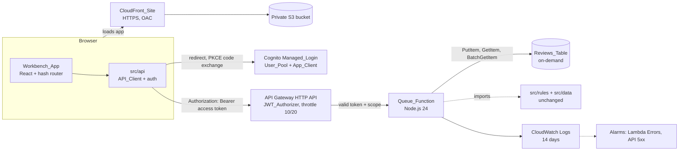
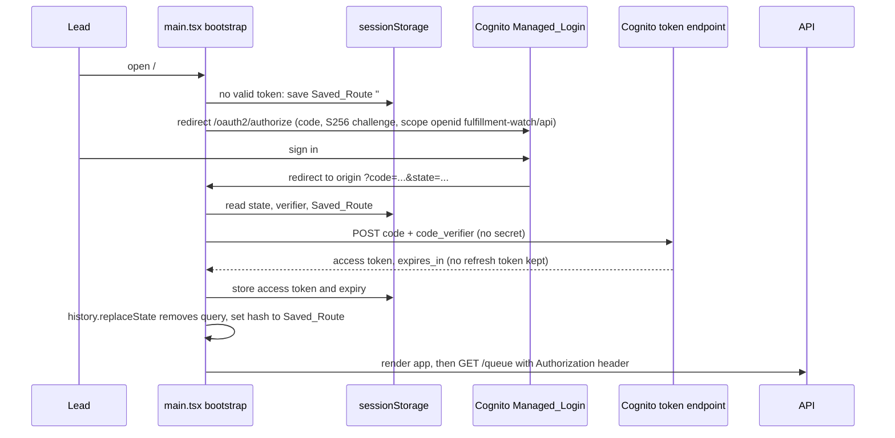
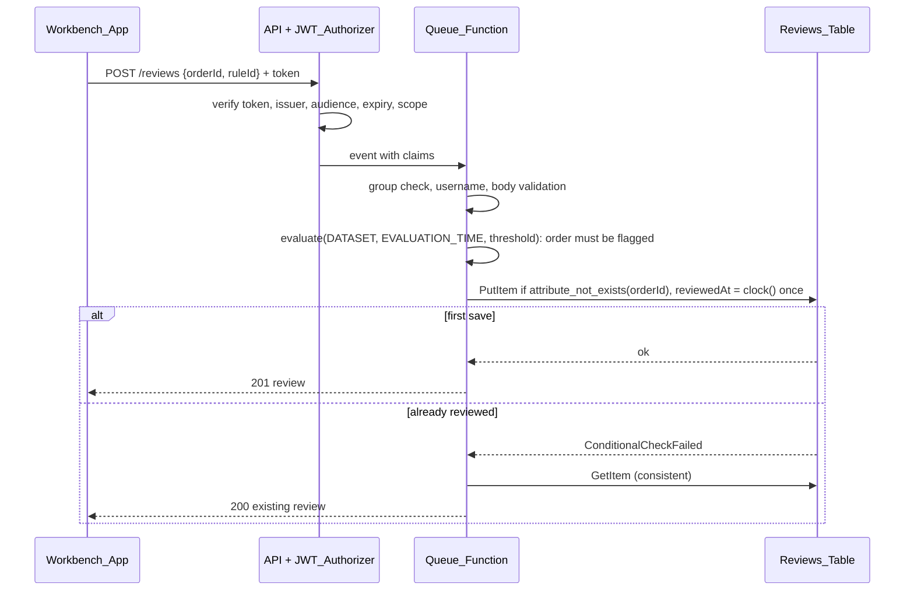

# Design Document

## Overview

Stage B puts the Stage A stalled-order queue behind a Cognito sign-in and saves reviews on a server. A signed-in fulfillment lead sees the same queue as Stage A, and a review made in one browser shows in any other, stored with the reviewer's Cognito username.

The design adds four things around the existing app and leaves the Stage A core alone:

- **A backend.** One Node.js Lambda behind an API Gateway HTTP API with a JWT authorizer. It serves `GET /queue` and `POST /reviews`, and stores reviews in a DynamoDB table.
- **A sign-in flow.** Cognito managed login with the authorization code grant and PKCE. A small callback runs in `src/main.tsx` before the router starts.
- **An API mode.** One build-time variable, `VITE_API_URL`, selects API mode (set) or the unchanged Stage A local mode (empty). All network code lives in one new module, `src/api`.
- **Infrastructure and hosting.** A CDK app defines everything, including a private S3 bucket behind CloudFront with OAC for the front end.

Fixed constraints that shape every decision below:

- `src/rules`, `src/data` and `src/storage/reviews.ts` are not changed. The Lambda imports `evaluate`, `buildQueue`, `reviewKey` and `validateOrder` from `src/rules` and `DATASET` from `src/data`. There is no second copy of the rule.
- The rule never reads the clock. The Lambda passes `EVALUATION_TIME` and `FULFILLMENT_THRESHOLD_HOURS` into `evaluate`. The one clock read in the backend is the review timestamp in `POST /reviews`, taken once per request and passed into the store as an argument.
- The page layout, hash routes and component structure from the UI redesign do not change. The only layout addition is a "Sign out" link in the header in API mode. The reviewer name goes into existing review status text.
- Data is synthetic and the region is us-east-1.

### Key design decisions

| Decision | Rationale |
| --- | --- |
| One Lambda for both routes, with a pure `handleRequest(event, deps)` function and a thin `handler.ts` that wires real dependencies | Requirement 14.4 needs the evaluation time and review timestamp passed in. The handler tests run `handleRequest` with an in-memory store and a fixed clock. |
| Reviews table keyed by partition key `orderId` and sort key `ruleId`, written with `PutItem` and `attribute_not_exists(orderId)` | The condition makes the first write win atomically, so concurrent requests cannot create two reviews or change the first timestamp (Requirements 5.3 to 5.5). |
| On a conditional-check failure the store reads the stored item with a consistent `GetItem` and returns it as an existing review | The repeat request gets 200 with the first timestamp and reviewer. |
| `GET /queue` reads reviews with `BatchGetItem` (consistent reads) for the flagged orders only | Least privilege: only `PutItem`, `GetItem` and `BatchGetItem` on one table ARN. No `Scan`, no `Query`, so no index ARN. Consistent reads make "save, then `GET /queue`" always return the new review (Requirement 5.8). |
| `GET /queue` returns one ordered `rows` array in evaluator order, each row with its review or `null` | Row order then equals the Stage A order by construction (Requirement 3.3). The client splits it into Open and Reviewed with the existing `buildQueue`. |
| The Lambda has its own `ReviewStore` interface and DynamoDB implementation, tested against an injected minimal `DynamoLike` fake | Requirement 7.11 needs a DynamoDB test double. A hand-written fake avoids a new test dependency such as `aws-sdk-client-mock`. |
| The Lambda reads `requestContext.authorizer.jwt.claims` and never calls Cognito | Requirement 1.8. Groups come from the `cognito:groups` claim. |
| The front end is deployed in two steps: `cdk deploy`, then build with the stack outputs and upload | The build needs the API URL and client ID, which exist only after the stack. A single `cdk deploy` with a bundled front end would create a circular dependency between the build and the stack. |
| Redirect URI is `window.location.origin` (no trailing slash), registered as `https://<distribution>.cloudfront.net` and `http://localhost:5173` | Cognito compares redirect URIs exactly. Requirement 2.3 fixes the two URLs. |
| `vite.config.ts` becomes `defineConfig(({ command }) => ...)`, with `base: command === 'build' ? '/' : '/absproxy/5173/'` | Requirement 13.6 and 13.7. This is the only change to that file. |
| `ReviewRecord` in `src/types.ts` gains an optional `reviewer` field | The queue rows need the reviewer in API mode. The existing `reviews.ts` ignores unknown fields when loading, so Stage A is unaffected. |

### Research findings

These findings come from AWS documentation looked up for this design, plus `docs/aws-notes.md`.

- **Managed login needs a paid-tier feature plan and explicit branding.** Managed login requires the Essentials or Plus feature plan; the Lite plan only offers the classic hosted UI ([Your first sign-in walkthrough](https://docs.aws.amazon.com/cognito/latest/developerguide/get-started-first-sign-in.html)). Creating a domain with managed login version 2 does not by itself turn on managed login pages for an app client, and an app client created programmatically has no branding style ([CreateUserPoolDomain API](https://docs.aws.amazon.com/AWSJavaScriptSDK/v3/latest/Package/-aws-sdk-client-cognito-identity-provider/Interface/CreateUserPoolDomainRequest/)). The Stack therefore sets the Essentials plan, creates the domain with managed login, and adds a `CfnManagedLoginBranding` resource for the app client that uses Cognito-provided default values. The Essentials plan has a per-user price that the Cost_Estimate must include.
- **JWT authorizer behavior** (from `docs/aws-notes.md` section 2). API Gateway validates signature, issuer, audience or `client_id`, expiry and the route's scopes, and passes claims at `requestContext.authorizer.jwt.claims`. AWS recommends requiring scopes on routes because a JWT alone does not distinguish access tokens from ID tokens. Every route here requires `fulfillment-watch/api`.
- **Claim formats.** HTTP API passes claims to the Lambda as strings. An array claim such as `cognito:groups` arrives as a bracketed string (for example `[fulfillment-lead]`), not always as a JSON array. The design parses both shapes (Requirement 1.5 to 1.7). This is verified in the deployed test (see Deployed verification).
- **S3, CloudFront and OAC** (`docs/aws-notes.md` section 3). Use `S3BucketOrigin.withOriginAccessControl`, set `defaultRootObject: 'index.html'`, and keep the bucket private. SPA 403/404 error rewrites are not needed because routing uses hash routes (Requirement 13.3).
- **Bundling** (`docs/aws-notes.md` section 4). `NodejsFunction` with `projectRoot` at the repository root lets esbuild include `src/rules` and `src/data`. `esbuild` is installed locally so CDK does not fall back to Docker.
- **Runtime** (`docs/aws-notes.md` section 5). `nodejs24.x`. The workspace runs Node 24, which also runs TypeScript files directly, so the CDK app can start with `node infra/bin/app.ts` and needs no `tsx` dependency. The repository already uses `.ts` import suffixes and `erasableSyntaxOnly`, which fits this.
- **HTTP API metric name.** The HTTP API server-error metric in `AWS/ApiGateway` is `5xx`, with the `ApiId` dimension. The alarm uses an explicit `Metric` for it.

## Architecture



### Repository layout (new and changed files)

```
fulfillment-watch/
├── infra/                       # new: CDK app
│   ├── bin/app.ts               #   reads context allowLocalhost, creates the Stack in us-east-1
│   ├── lib/stack.ts             #   FulfillmentWatchStack
│   ├── stack.test.ts            #   synth and assertion tests
│   └── cdk.json                 #   "app": "node infra/bin/app.ts"
├── server/                      # new: Lambda code (imports ../src/rules, ../src/data, ../src/config.ts)
│   ├── handler.ts               #   Lambda entry: wires real clock, DynamoDB client, env
│   ├── handleRequest.ts         #   pure router + GET /queue + POST /reviews
│   ├── claims.ts                #   claim parsing: username, groups, scopes
│   ├── runtimeConfig.ts         #   parse and validate the two environment variables
│   ├── reviewStore.ts           #   ReviewStore interface + DynamoReviewStore + DynamoLike
│   ├── responses.ts             #   JSON response builders and the error body shape
│   └── *.test.ts
├── scripts/
│   └── verify-deployed-api.mjs  # new: deployed checks (401, 404, missing scope); takes tokens from env
├── src/
│   ├── api/                     # new: the only module that makes network calls
│   │   ├── config.ts            #   reads VITE_* values, isApiMode
│   │   ├── client.ts            #   getQueue, postReview, 10 s timeout, typed errors
│   │   ├── auth.ts              #   token storage, sign-in redirect, callback, sign-out URL
│   │   ├── pkce.ts              #   verifier, challenge, state
│   │   ├── wire.ts              #   QueueResponse encode/decode
│   │   └── index.ts
│   ├── storage/
│   │   ├── reviewRepository.ts  # new: ReviewRepository interface
│   │   ├── localRepository.ts   # new: wraps reviews.ts
│   │   └── apiRepository.ts     # new: wraps src/api client
│   ├── main.tsx                 # changed: async bootstrap with sign-in callback
│   ├── state/WorkbenchProvider.tsx, workbenchContext.ts   # changed: repository + load status
│   ├── components/Header.tsx    # changed: optional Sign out link
│   ├── components/SignInMessage.tsx  # new: sign-in failed and not-in-group messages
│   ├── components/LoadStatus.tsx     # new: loading and error-with-retry states
│   └── types.ts                 # changed: optional reviewer on ReviewRecord
├── tsconfig.server.json         # new: server, infra, scripts and the shared src files they import
├── vite.config.ts               # changed: base by command
├── docs/cost-estimate.md, docs/scope-verification.md   # new
└── README.md                    # changed: deploy, user, group, run, threshold, teardown
```

### Sign-in sequence



### Review sequence



## Components and Interfaces

### Backend: Queue_Function (`server/`)

**Event and dependency types.** The handler uses a minimal event type instead of adding `@types/aws-lambda`:

```ts
interface ApiEvent {
  routeKey?: string
  rawPath?: string
  body?: string | null
  isBase64Encoded?: boolean
  requestContext: {
    http: { method: string; path: string }
    authorizer?: { jwt?: { claims?: Record<string, unknown>; scopes?: string[] | null } }
  }
}
interface ApiResult { statusCode: number; headers: Record<string, string>; body: string }

interface HandlerDeps {
  store: ReviewStore
  env: Readonly<Record<string, string | undefined>>
  clock: () => string          // returns ISO 8601 UTC with milliseconds and Z; called once per POST
  dataset: readonly RawOrder[] // DATASET in production
  log: (entry: Record<string, unknown>) => void
}
function handleRequest(event: ApiEvent, deps: HandlerDeps): Promise<ApiResult>
```

**Request flow in `handleRequest`:**

1. Route on `method` and `path`. Anything other than `GET /queue` and `POST /reviews` returns 404 `{error:{code:'not_found', message:'Route not found'}}`. API Gateway already returns 404 for undefined routes, so this is a second line of defense (Requirement 6.7, 3.9).
2. Authorize: parse claims (`claims.ts`). If the user is not in `fulfillment-lead`, return 403 with no data (Requirement 1.5, 1.6). The scope is enforced by the authorizer, so the function does not re-check it.
3. Parse and validate the runtime configuration (`runtimeConfig.ts`). A bad value returns 500 with a generic body (Requirement 4.5, 4.6).
4. Run the route.

**`GET /queue`:**

1. `evaluate(dataset, evaluationTime, thresholdHours)`. Query parameters and body are never read (Requirement 4.7).
2. `store.getMany` for every flagged `(orderId, RULE_ID)`.
3. Build `rows` in evaluator order, each with `review: null` or `{reviewedAt, reviewer}`. Reviews for orders that do not match are never fetched, so they are omitted from the response and left unchanged in the table (Requirement 3.6).
4. Return 200 with the `QueueResponse`. Any evaluation or store error returns 500 with a generic body, never a partial queue (Requirement 3.10).

**`POST /reviews`:**

1. Require a `username` claim, else 403 and no write (Requirement 5.10). This is a design choice: the request is authenticated but cannot be attributed, so 403 fits better than 401, which would send the client into a sign-in loop.
2. Decode the body (handle `isBase64Encoded`), parse JSON, and require `orderId` and `ruleId` to be non-empty strings. Otherwise 400 with a message naming the field or the body (Requirement 6.1). Any other field, including `reviewer`, is ignored (Requirement 5.9).
3. `ruleId` must equal `RULE_ID` (`paid-unfulfilled`), else 400 "rule ID is not supported" (Requirement 6.2).
4. Evaluate the dataset. `orderId` must be among the flagged orders, else 400 "order is not in the queue" (Requirement 6.3). A repeat review of an order that is still flagged passes this check and reaches the store.
5. `reviewedAt = deps.clock()`, read once, then `store.save(orderId, ruleId, reviewedAt, username)`.
6. Return 201 with the saved review if `created`, 200 with the existing review if not. Store failure returns 500 with a generic body (Requirement 6.4, 5.11).

**Responses (`responses.ts`).** Every error body has the shape `{"error":{"code":"...","message":"..."}}`. Error codes are `invalid_request` (400), `forbidden` (403), `not_found` (404), and `internal_error` (500). The 500 message is the fixed text "The request could not be completed." and never includes a variable name, a value, a stack trace, or a resource name (Requirement 4.5, 6.5). Logging for 5xx writes one JSON line with `operation`, `errorName` and `message` of the cause. It never logs the event, headers, claims or the `Authorization` value (Requirement 6.6, 12.6).

**`claims.ts`:**

```ts
function readUsername(claims: Record<string, unknown> | undefined): string | null
function readGroups(claims: Record<string, unknown> | undefined): readonly string[]
function isLead(claims: Record<string, unknown> | undefined): boolean
```

`readGroups` accepts a real array, a bracketed string such as `[a b]` or `[a, b]`, a JSON array string, or a plain single name. An absent, empty, or unparsable claim gives an empty list, which means not a lead (Requirement 1.6). `readUsername` accepts a non-empty string only.

**`runtimeConfig.ts`:**

```ts
type RuntimeConfig = { evaluationTime: string; thresholdHours: number }
function readRuntimeConfig(env): { ok: true; config: RuntimeConfig } | { ok: false }
```

- `FULFILLMENT_THRESHOLD_HOURS`: unset gives `DEFAULT_THRESHOLD_HOURS`. If set, it must match `^\d+(\.\d+)?$`, be finite, and be greater than 0. Whitespace-padded values, exponent forms, hex, `NaN`, `Infinity`, empty strings and `0` are rejected.
- `EVALUATION_TIME`: unset gives the `EVALUATION_TIME` constant from `src/config.ts`. If set, `parseUtcTimestamp` from `src/rules/timestamps.ts` must accept it. That function already requires a trailing `Z` and checks the calendar date, so `2026-02-30T00:00:00Z`, values without `Z`, and non-UTC offsets are rejected. It accepts milliseconds with exactly three digits.
- The result carries no detail on failure, so the 500 body cannot leak the variable name or value.

**`reviewStore.ts`:**

```ts
interface StoredReview { orderId: string; ruleId: string; reviewedAt: string; reviewer: string }
interface ReviewStore {
  getMany(keys: ReadonlyArray<{ orderId: string; ruleId: string }>): Promise<ReadonlyMap<string, StoredReview>> // keyed by reviewKey
  save(orderId: string, ruleId: string, reviewedAt: string, reviewer: string): Promise<{ created: boolean; review: StoredReview }>
}
class ReviewStoreError extends Error { readonly operation: 'save' | 'get' }
```

- `DynamoReviewStore` takes a `DynamoLike` (`putIfAbsent`, `get`, `batchGet`) so tests can inject a fake. The production `DynamoLike` adapts `@aws-sdk/lib-dynamodb` `DynamoDBDocumentClient`.
- `save` calls `PutItem` with `ConditionExpression: attribute_not_exists(orderId)`. A `ConditionalCheckFailedException` triggers a consistent `GetItem` and returns `{created:false, review}`. Any other failure throws `ReviewStoreError('save')` and writes nothing else (Requirement 7.10).
- `getMany` splits keys into chunks of 100, uses `ConsistentRead: true`, and retries `UnprocessedKeys` a bounded number of times, then throws `ReviewStoreError('get')`. It never mutates the table.
- The store never reads the clock (Requirement 7.9). The store keys results with `reviewKey` from `src/rules/queue.ts`.

### Front end: API client and auth (`src/api`)

All network access in the browser, including the Cognito token call, lives here. Local mode never imports a path that calls `fetch`.

```ts
// config.ts
function isApiMode(value: string | undefined): boolean         // true iff value has a non-whitespace character
// client.ts
interface ApiClient {
  getQueue(): Promise<QueueResponse>
  postReview(orderId: string, ruleId: string): Promise<{ review: ApiReview; created: boolean }>
}
type ApiErrorKind = 'unauthorized' | 'forbidden' | 'timeout' | 'network' | 'http'
class ApiError extends Error { readonly kind: ApiErrorKind; readonly status?: number }
```

- Each request uses `AbortController` with a 10 000 ms timer. An abort becomes `ApiError('timeout')`. A `TypeError` from `fetch` becomes `network`. 401 becomes `unauthorized`, 403 `forbidden`, other non-2xx `http`. Error messages never include a raw response body (Requirement 9.9).
- Every request sets `Authorization: Bearer <access token>` read from `auth.ts` (Requirement 2.9). `fetch`, the clock, and `sessionStorage` are injected, so tests need no network.

```ts
// auth.ts
function getValidToken(now: number): string | null            // null if absent or expired
function startSignIn(): void                                  // save Saved_Route, state, verifier; redirect
function completeSignIn(): Promise<'signed-in' | 'failed' | 'none'>  // handle ?code= or ?error=
function signOutUrl(): string                                 // Cognito /logout URL (see OQ-15 proposal)
function clearTokens(): void
```

- Storage keys in `sessionStorage`: `fw.token` (access token and expiry), `fw.pkce` (verifier and state), `fw.route` (Saved_Route). None of these is a review entry (Requirement 8.7). No refresh token is requested or stored (Requirement 2.10).
- The authorize request uses `response_type=code`, `client_id`, `redirect_uri=window.location.origin`, `scope=openid fulfillment-watch/api` (Cognito adds `cognito:groups` to the access token only when `openid` is requested, observed on the deployed pool on 2026-11-20), `state`, `code_challenge`, `code_challenge_method=S256`.
- The token request is a form-encoded `POST` to `<cognito domain>/oauth2/token` with `grant_type=authorization_code`, `client_id`, `code`, `redirect_uri`, `code_verifier`. No client secret exists.
- `pkce.ts` generates a 64-character verifier from `crypto.getRandomValues` over the unreserved character set and computes `base64url(SHA-256(verifier))` with `crypto.subtle`. The crypto object is a parameter so tests can supply Node's.
- The token expiry is the response `expires_in` added to the time of exchange, minus a 30-second skew. The expiry check uses `Date.now()` in `auth.ts` only. This is client session logic, not rule logic.

### Front end: bootstrap and state

**`main.tsx`** becomes an async bootstrap. In Local mode it renders exactly as today.

```ts
async function bootstrap() {
  if (!isApiMode(import.meta.env.VITE_API_URL)) return render(<LocalApp />)
  const outcome = await completeSignIn()               // handles ?code= and ?error=
  if (outcome === 'failed') return render(<SignInMessage kind="failed" onRestart={startSignIn} />)
  if (getValidToken(Date.now()) === null) return startSignIn()   // redirects; nothing renders
  render(<ApiApp />)                                    // HashRouter reads the restored hash
}
```

`completeSignIn` validates `state`, exchanges the code, calls `history.replaceState` to drop the query, and sets the hash to the Saved_Route before the router is created, so `HashRouter` starts on the restored route (Requirement 2.8, 13.4). If no Saved_Route exists, it uses `#/` (see OQ-17 proposal).

**`ReviewRepository` (`src/storage/reviewRepository.ts`)** (signature proposed under OQ-16):

```ts
type SaveOutcome =
  | { ok: true; created: boolean; review: ReviewRecord }
  | { ok: false; error: ApiErrorLike | { kind: 'storage'; message: string } }
interface ReviewRepository {
  get(orderId: string, ruleId: string): Promise<ReviewRecord | null>   // empty result, never an error, when absent
  list(): Promise<ReviewMap>
  save(orderId: string, ruleId: string, requestedAt: string): Promise<SaveOutcome>
}
```

- `LocalRepository` wraps `loadReviews` and `saveReview` from `reviews.ts` with a `StorageLike`, and uses `requestedAt` as the timestamp.
- `ApiRepository` wraps the API client. `save` ignores `requestedAt` because the server stamps the time and reviewer. It also exposes `loadQueue(): Promise<QueueResponse>`, and `list` and `get` derive from the latest `loadQueue` result.
- Both identify reviews by `reviewKey(orderId, ruleId)` (Requirement 7.5).

**`WorkbenchProvider`** takes a `repository` prop. Its behavior by mode:

- **Local mode.** The initial state is still computed synchronously (`evaluate` and `loadReviews`), so every existing test renders as before. `markReviewed` calls `repository.save` and applies the returned reviews when the promise settles. Risk and fallback: if an existing test depends on the state change happening in the same tick as the click, the Local path applies the result through a synchronous fast path in `LocalRepository` (it exposes `saveSync`), and the async `save` delegates to it. The existing suite is run unchanged to decide this (Requirement 14.8).
- **API mode.** Initial state is `status: 'loading'`. The provider calls `loadQueue()` on mount and on "Re-run evaluation". On success it builds `result` (`flagged` from `rows`, `skipped`, `checkedCount`), `reviews`, and `evaluationTime`/`thresholdHours` from the response, and `status: 'ready'`. On failure `status` is `'error'` (with a Retry action) or `'forbidden'` (no Retry). A 401 calls `startSignIn()`.

The context type gains optional fields so existing consumers and tests compile unchanged: `mode`, `status`, `errorKind`, `evaluationTime`, `reload()`, and `saveRetryFor`. In Local mode they take their defaults (`'local'`, `'ready'`).

**`Shell` (`App.tsx`).** If `status` is `loading`, it renders `LoadStatus` (loading text). If `error`, `LoadStatus` renders the message "Could not load the queue." with a Retry button that is disabled while loading. If `forbidden`, `SignInMessage kind="not-in-group"` renders with no Retry and no automatic redirect (Requirement 2.17, 9.8). Otherwise the page renders as today. The header shows the Evaluation_Time and checked count from the response in API mode (Requirement 8.10).

**Review status text.** A pure helper `formatReviewStatus(review)` in `src/format.ts` returns `Reviewed by lead1 2026-11-20 12:05 UTC` style text when `reviewer` is present, and the existing text when it is not. `OrderPage` and `QueueTable` call it in place of the current inline text, so no element is added (Requirement 5.12). The inline save error in `OrderPage` and `QueueTable` gets a Retry button in API mode that calls `markReviewed` again for the same order (Requirement 9.4, 9.5).

**Header.** `Header` gains an optional `onSignOut`/`signOutHref` prop. When set (API mode only), it renders an `<a>` "Sign out" inside the existing `<header>`. The link clears tokens and then follows the Cognito logout URL (Requirement 2.14 to 2.16). Local mode passes nothing, so nothing renders (Requirement 2.15).

**Message screens.** `SignInMessage` is a small component with `kind: 'failed' | 'not-in-group'`. `failed` offers a "Sign in again" button that calls `startSignIn` (Requirement 2.18, 13.5). Neither shows queue data.

### Infrastructure: `FulfillmentWatchStack` (`infra/lib/stack.ts`)

| Resource | Configuration |
| --- | --- |
| Region | `env: { region: 'us-east-1' }`; the app reads context `allowLocalhost` (default false) |
| `UserPool` | `selfSignUpEnabled: false`, username sign-in, feature plan Essentials, removal policy `DESTROY`, no MFA for the pilot, `signInPolicy`/`passwordPolicy` at Cognito defaults or stronger |
| `UserPoolGroup` | One group, `fulfillment-lead` |
| `UserPoolResourceServer` | Identifier `fulfillment-watch`, scope `api` |
| `UserPoolDomain` | Prefix `fulfillment-watch-690559`, managed login version 2 |
| `UserPoolClient` | `generateSecret: false`; flows `authorizationCodeGrant` only; OAuth scopes `fulfillment-watch/api` and `openid` (for the scope check in Deployed verification); callback URLs exactly `https://<distribution domain>` and `http://localhost:5173`; logout URLs the same two (OQ-15 proposal); access token validity 1 hour (OQ-17 proposal); no refresh token use by the app |
| `CfnManagedLoginBranding` | For the client, Cognito-provided default values, so managed login pages render |
| `Table` (Reviews_Table) | Partition key `orderId` (S), sort key `ruleId` (S), `PAY_PER_REQUEST`, removal policy `DESTROY` |
| `LogGroup` for the function | Retention `TWO_WEEKS`, removal policy `DESTROY` |
| `NodejsFunction` (Queue_Function) | `entry: server/handler.ts`, `projectRoot` repository root, `depsLockFilePath: package-lock.json`, runtime `NODEJS_24_X`, architecture arm64, memory 256 MB, timeout 10 s, environment `REVIEWS_TABLE_NAME`, `EVALUATION_TIME`, `FULFILLMENT_THRESHOLD_HOURS`. Its own role. |
| IAM grant | `dynamodb:PutItem`, `dynamodb:GetItem`, `dynamodb:BatchGetItem` on the table ARN only. No wildcards. Written as an explicit `PolicyStatement`, not `grantReadWriteData`, which adds more actions. |
| `HttpApi` | Routes `GET /queue` and `POST /reviews` only, each with the JWT authorizer (`HttpJwtAuthorizer`, issuer `https://cognito-idp.us-east-1.amazonaws.com/<poolId>`, audience the client ID) and `authorizationScopes: ['fulfillment-watch/api']`. CORS: allowed origins are the CloudFront URL, plus `http://localhost:5173` when `allowLocalhost` is true; methods `GET`, `POST`, `OPTIONS`; headers `Authorization`, `Content-Type`. |
| Stage throttling | Default route settings `throttlingRateLimit: 10`, `throttlingBurstLimit: 20`, set on the stage's `CfnStage` |
| Site bucket | Private, all four Block Public Access settings, S3-managed encryption, `enforceSSL`, removal policy `DESTROY`, `autoDeleteObjects: true` |
| `Distribution` | S3 origin with OAC, `defaultRootObject: 'index.html'`, `viewerProtocolPolicy: REDIRECT_TO_HTTPS`, price class 100 |
| Alarms | `Errors` Sum >= 1 over one 5-minute period on the function; `5xx` Sum >= 1 over one 5-minute period on the API (`treatMissingData: NOT_BREACHING`). No SNS topic, no actions. |
| Outputs | API URL, user pool ID, app client ID, Cognito domain URL, site URL, bucket name, distribution ID. None is a secret. |

Notes on the table:

- The CloudFront domain is a CloudFormation token. The app client and the API CORS configuration use it without a cycle, because the distribution does not depend on either.
- `autoDeleteObjects` adds a CDK-managed custom resource function used only at delete time. Its log group is created by Lambda, not by the Stack. The Stack's own log group is the Queue_Function group. This is a known trade-off for a one-command teardown (Requirement 10.5).
- A failed `cdk deploy` rolls back through CloudFormation's default behavior, and the failing resource appears in the stack events (Requirement 10.4). The Stack sets no stack policy or termination protection.
- The Stack contains no secret. The app client has no secret, the table name is not secret, and no password is stored anywhere (Requirement 10.13).

### Deploy flow

1. `npm run cdk -- deploy -c allowLocalhost=false` (deployment always uses false, Requirement 11.10).
2. Build with the outputs: `VITE_API_URL=<ApiUrl> VITE_COGNITO_DOMAIN=<CognitoDomainUrl> VITE_COGNITO_CLIENT_ID=<ClientId> npm run build`. The build uses base `/`.
3. `aws s3 sync dist s3://<bucket> --delete`, then `aws cloudfront create-invalidation --distribution-id <id> --paths '/*'`.
4. Create the test user and add the user to `fulfillment-lead` (admin commands, password set by hand, never committed).

The README documents each step with the expected result. Local API-mode development uses `VITE_API_URL=... npx vite --base /` with `allowLocalhost=true`. The CLI `--base` flag keeps `vite.config.ts` unchanged beyond the approved `base` function, and the `/` base is needed because Cognito redirects to `http://localhost:5173` with the code at the root, not under `/absproxy/5173/`.

### Deployed verification

`scripts/verify-deployed-api.mjs` is a Node script (no dependencies, built-in `fetch`) that reads `API_URL` and, optionally, `TOKEN_NO_SCOPE` and `TOKEN_NO_GROUP` from the environment. It never stores or prints a token. It checks and prints the observed status for:

1. No token on `GET /queue` (expected 401).
2. Malformed token (expected 401).
3. A valid token without the Required_Scope (expected 403, unverified until run) (Requirement 1.4, 1.10).
4. A valid token with the scope for a user outside the group (expected 403 from the Queue_Function).
5. `GET /reviews` (expected 404).
6. The CORS headers on a 401 and a 403 response, to confirm the browser can read them (a risk, see Error Handling).

To get a token without the scope, the operator signs in through the app client requesting only `openid` (the client allows it), copies the access token from the response, and passes it in the environment. `docs/scope-verification.md` records the observed status and date. If the status is not 403, Requirement 1.4 and every requirement that states the missing-scope status are corrected to the observed code (Requirement 1.11).

### Proposals for the open questions

These four are proposals for the user to confirm. They are not decided.

**OQ-15: Sign-out scope (proposal).** Sign out clears the local tokens and then navigates to the Cognito logout endpoint (`<domain>/logout?client_id=...&logout_uri=<origin>`), which ends the hosted session. This needs `logoutUrls` on the app client, set to the same two origins as the callback URLs. After the redirect back, the app finds no token and starts sign-in, so the next user must enter a password. Alternative: clear tokens only. That is simpler, but the next sign-in may complete without a password prompt on a shared machine.

**OQ-16: ReviewRepository save signature (proposal).** `save(orderId, ruleId, requestedAt)` returns `{ok, created, review}`. `requestedAt` is the click-time ISO timestamp the provider already creates from its injected `now`. `LocalRepository` stores it. `ApiRepository` ignores it, because the server stamps the time and the reviewer, and returns the server's review. Alternative: no timestamp argument and let `LocalRepository` take a clock in its constructor. That makes the interface cleaner, but then Stage A tests must inject the clock at construction instead of through the `App` `now` prop they use today.

**OQ-17: Token lifetime and Saved_Route fallback (proposal).** Set the access token validity to 1 hour explicitly in the Stack (the Cognito default, made visible in code). When the token expires, the next load or a 401 sends the user through sign-in, and the Saved_Route brings them back. If no Saved_Route exists after sign-in, the app shows `#/` (the Open queue). A longer lifetime is possible, but 1 hour is a reasonable limit without refresh tokens.

**OQ-18: Missing-scope status (proposal for how to close it).** The status stays unverified, with 403 expected. It closes when the operator runs `scripts/verify-deployed-api.mjs` against the deployed API and records the result in `docs/scope-verification.md`. The `openid`-only token method above needs no second app client. Alternative: a test-only second app client without the custom scope, which adds a resource and a second client ID to the Stack.

## Data Models

### Review (DynamoDB item, Reviews_Table)

| Attribute | Type | Notes |
| --- | --- | --- |
| `orderId` | S, partition key | Order ID as supplied |
| `ruleId` | S, sort key | Always `paid-unfulfilled` in this stage |
| `reviewedAt` | S | ISO 8601 UTC with milliseconds and `Z`, from the single clock read |
| `reviewer` | S | `username` claim of the access token |

At most one item exists per `(orderId, ruleId)` because of the key and the `attribute_not_exists` condition. Items are never updated or deleted by the function.

### Wire types (`GET /queue` and `POST /reviews`)

```ts
interface WireReview { reviewedAt: string; reviewer: string }

interface WireRow {
  order: Order            // as produced by validateOrder (orderId, paymentStatus, paidAtMs, paidAt, canceled, refundStatus, orderedQuantity, fulfilledQuantity)
  elapsedMs: number
  review: WireReview | null   // reviewedAt and reviewer present only when reviewed
}

interface QueueResponse {
  ruleId: string                      // 'paid-unfulfilled'
  evaluationTime: string
  thresholdHours: number
  checkedCount: number
  rows: readonly WireRow[]            // evaluator order
  skipped: readonly SkippedRecord[]   // with reasons, evaluator order
}

// POST /reviews request:  { "orderId": string, "ruleId": "paid-unfulfilled" }   (other fields ignored)
// POST /reviews response: { "orderId": string, "ruleId": string, "reviewedAt": string, "reviewer": string }
// Error body:             { "error": { "code": string, "message": string } }
```

`src/api/wire.ts` holds `encodeQueueResponse` (server side, shared by the Lambda) and `decodeQueueResponse` (client side). The decoder checks the shape and throws a typed `ApiError('http')` for a malformed body, so a bad response shows the retryable error state instead of crashing. The decoded rows map to `FlaggedOrder` (`{order, elapsedMs}`) and a `ReviewMap` keyed by `reviewKey`, so `buildQueue` and every existing page work unchanged.

### Status codes

| Case | Status | Source |
| --- | --- | --- |
| No token, malformed token, bad signature, wrong issuer, expired | 401 | API Gateway |
| Valid token without `fulfillment-watch/api` | 403 expected, unverified | API Gateway |
| Valid token, user not in `fulfillment-lead` or groups claim absent or empty | 403 | Queue_Function |
| Valid token without a `username` claim on `POST /reviews` | 403 | Queue_Function |
| `GET /queue` success | 200 | Queue_Function |
| `POST /reviews` first save | 201 | Queue_Function |
| `POST /reviews` repeat | 200 | Queue_Function |
| Bad body, unsupported rule ID, order not in queue | 400 | Queue_Function |
| Any other route or method (including `GET /reviews`) | 404 | API Gateway, then Queue_Function |
| Rate above 10 per second steady or 20 burst | 429 | API Gateway |
| Bad configuration value, store failure, evaluation failure | 500 | Queue_Function |

### Client storage

| Key | Where | Content |
| --- | --- | --- |
| `fw.token` | `sessionStorage` | Access token and expiry time |
| `fw.pkce` | `sessionStorage` | PKCE verifier and state for the in-flight sign-in |
| `fw.route` | `sessionStorage` | Saved_Route |
| `fulfillment-watch.reviews.v1` | `localStorage` | Stage A reviews, Local mode only. Not written in API mode. |

## Correctness Properties

*A property is a characteristic or behavior that should hold true across all valid executions of a system-essentially, a formal statement about what the system should do. Properties serve as the bridge between human-readable specifications and machine-verifiable correctness guarantees.*

Testing with generated inputs applies to the handler logic, the review store, claim and configuration parsing, the wire format, and the sign-in helpers. It does not apply to the CDK Stack, Cognito, API Gateway, CloudFront, or layout; those use assertion, synth, deployed and component example tests (see Testing Strategy). Redundant criteria were merged: the queue criteria into the first property, the first-wins criteria into the eighth, and the validation criteria into the twelfth.

### Property 1: Queue response equals the Stage A evaluator

For any dataset of raw orders (valid and invalid records), any valid threshold, any valid evaluation time and any set of stored reviews, the `GET /queue` response SHALL have `rows` whose orders, elapsed times and order equal `evaluate(...).flagged`, the same `checkedCount` and `skipped` records with reasons as `evaluate(...)`, the configured `evaluationTime`, `thresholdHours` and rule ID, one row per matching order, a `review` with `reviewedAt` and `reviewer` only on rows that have a stored review, and calling it twice SHALL return identical responses.

**Validates: Requirements 3.1, 3.3, 3.4, 3.5, 3.7, 4.9, 4.10, 14.6**

### Property 2: Stale reviews are omitted and kept

For any set of stored reviews that includes reviews for orders the rule does not flag, the `GET /queue` response SHALL contain no row for those orders, and the stored reviews SHALL be identical before and after the request.

**Validates: Requirements 3.6**

### Property 3: Group membership decides access

For any claims object, where the `cognito:groups` claim is a list, a bracketed string, a JSON array string, a single name, empty or absent, and any other claim values, the Queue_Function SHALL process the request if and only if the groups contain `fulfillment-lead`; otherwise it SHALL return 403 with a body that contains no order data and SHALL not write to the store.

**Validates: Requirements 1.5, 1.6, 1.7**

### Property 4: Unknown routes return 404

For any HTTP method and path other than `GET /queue` and `POST /reviews`, including `GET /reviews`, the Queue_Function SHALL return 404 with a not-found error body and no review data, and SHALL not write to the store.

**Validates: Requirements 3.9, 6.7**

### Property 5: Valid configuration is used as given

For any decimal string greater than 0 that matches `^\d+(\.\d+)?$` and any valid UTC timestamp, the runtime configuration SHALL return exactly those values, and for an unset variable it SHALL return `DEFAULT_THRESHOLD_HOURS` or the `EVALUATION_TIME` constant from `src/config.ts`.

**Validates: Requirements 4.1, 4.2, 4.3, 4.4**

### Property 6: Invalid configuration returns a generic 500

For any invalid value of `FULFILLMENT_THRESHOLD_HOURS` (empty, whitespace, non-numeric, zero, negative, `NaN`, `Infinity`, exponent or padded forms) or `EVALUATION_TIME` (empty, no `Z`, a non-UTC offset, an impossible calendar date), the Queue_Function SHALL return 500 with the fixed generic body that contains neither the variable name, the rejected value, nor any order data, and SHALL not return a partial queue.

**Validates: Requirements 4.5, 4.6**

### Property 7: Request parameters do not change the result

For any query parameters or body fields named like a threshold or evaluation time, the `GET /queue` response SHALL equal the response to the same request without them.

**Validates: Requirements 4.7**

### Property 8: Saving a review repeatedly keeps the first record

For any review `(orderId, ruleId, reviewedAt, reviewer)` and any N from 1 to 10 save requests for the same order and rule with arbitrary later timestamps and reviewers, the stored record SHALL equal the record from the first save, the first response SHALL be 201 and every later response SHALL be 200 with the first record, and the table SHALL hold exactly one review for that pair.

**Validates: Requirements 5.3, 5.4, 5.6, 7.6, 7.8, 14.7**

### Property 9: Concurrent saves keep exactly one review

For any K from 2 to 10 simultaneous save requests for the same flagged order with distinct reviewers, against a store whose conditional write is atomic, exactly one response SHALL be 201, the others SHALL be 200, every response body SHALL carry the same timestamp and reviewer, and the table SHALL hold exactly one review.

**Validates: Requirements 5.5**

### Property 10: Save then queue round trip

For any flagged order and any reviewer, after a successful `POST /reviews`, `GET /queue` SHALL return the matching row with the saved `reviewedAt` and `reviewer`, including when the request is served from a fresh handler instance sharing only the store.

**Validates: Requirements 5.7, 5.8**

### Property 11: The reviewer is the token username

For any `username` claim and any request body that contains extra fields, including a `reviewer` field with any value, the saved review SHALL have `reviewer` equal to the `username` claim, and when the claim is absent or empty the response SHALL be 403 and no review SHALL be created.

**Validates: Requirements 5.9, 5.10**

### Property 12: Invalid review requests return 400 and write nothing

For any `POST /reviews` body that is missing, empty, not valid JSON, lacks a non-empty string `orderId` or `ruleId`, has a `ruleId` other than `paid-unfulfilled`, or names an order that is not flagged, the Queue_Function SHALL return 400 with an error message that identifies the cause, and the store SHALL record no write.

**Validates: Requirements 6.1, 6.2, 6.3**

### Property 13: Failures do not leak internals or credentials

For any injected error message, stack text and `Authorization` header value, a 5xx response body SHALL equal the fixed generic body, SHALL contain none of the injected text, and the log entry for it SHALL contain the cause but SHALL not contain the `Authorization` value.

**Validates: Requirements 6.4, 6.5, 6.6, 12.6**

### Property 14: Local and Lambda stores agree

For any sequence of 1 to 50 save operations, each with an order ID, rule ID, timestamp and reviewer, the `Local_Review_Store` and the `Lambda_Review_Store` (against the DynamoDB fake) SHALL return the same `reviewedAt` for every order and rule pair when queried afterwards, the same reviewer as the first save of that pair, and an empty result without an error for any pair that was never saved.

**Validates: Requirements 7.7, 7.8, 7.11**

### Property 15: Mode selection follows the build value

For any string value of `VITE_API_URL`, including `undefined`, `isApiMode` SHALL return true if and only if the value contains at least one non-whitespace character.

**Validates: Requirements 8.1, 8.2**

### Property 16: Wire format round trip

For any valid `QueueResponse`, decoding the JSON text of the encoded response SHALL produce a value equal to the original, and for any value that is not a valid `QueueResponse` the decoder SHALL fail with a typed error instead of returning partial data.

**Validates: Requirements 3.3, 8.10**

### Property 17: PKCE challenge matches the verifier

For any generated verifier, the verifier SHALL be 43 to 128 characters from the unreserved set, and the challenge SHALL equal the unpadded base64url encoding of the SHA-256 digest of the verifier.

**Validates: Requirements 2.7**

### Property 18: Sign-in preserves the route

For any hash route saved before sign-in, starting sign-in SHALL store that route and build an authorize URL with `response_type=code`, the Required_Scope, `code_challenge_method=S256` and a `state`, and a successful callback with that `state` SHALL leave a URL with no query string whose hash equals the saved route; with no saved route the hash SHALL be `#/`.

**Validates: Requirements 2.6, 2.7, 2.8, 13.4**

### Property 19: Expired tokens are discarded

For any stored token expiry and current time, `getValidToken` SHALL return the token if and only if the current time is before the expiry, and a returned `null` SHALL leave no token in `sessionStorage`.

**Validates: Requirements 2.11**

### Property 20: Review status text names the reviewer

For any review with a non-empty reviewer, the status text SHALL contain the reviewer name and the formatted UTC review time; for any review with no reviewer, the status text SHALL equal the Stage A text.

**Validates: Requirements 5.12, 8.9**

## Error Handling

| Situation | Behavior |
| --- | --- |
| Missing, malformed, expired or wrongly issued token | API Gateway returns 401 before the function runs. The app discards the token and starts sign-in (Requirement 2.19, 9.7). |
| Token without the Required_Scope | Expected 403 from API Gateway (unverified). The app treats any 403 as not-in-group and shows the permission message with no Retry. |
| User not in `fulfillment-lead` | The function returns 403 and no data. The app shows "This account is not in the fulfillment-lead group", does not redirect, and does not show queue data. |
| Invalid request body, rule or order | 400 with a message naming the field (for example "orderId must be a non-empty string"). The app keeps the order in Open and shows the inline error with Retry. |
| Invalid `FULFILLMENT_THRESHOLD_HOURS` or `EVALUATION_TIME` | 500 with the fixed generic body. The log entry names the cause (the variable and why it was rejected). The body does not. |
| DynamoDB failure or evaluation failure | 500 with the fixed generic body. A failed save does not mark the order reviewed. A failed queue read returns no partial queue. A log entry with the cause is written. |
| Client timeout (10 s) or network error | `ApiError('timeout' or 'network')`. `GET /queue` shows "Could not load the queue." with a Retry button that is disabled while loading. `POST /reviews` shows an inline error with Retry next to the order and keeps the current page and selection. |
| Malformed success response | The decoder throws `ApiError('http')`. The app shows the retryable error state. |
| Token exchange failure, `?error=` redirect, state mismatch | The app shows "Sign-in failed" with a "Sign in again" button, removes the query from the URL, and shows no queue data. |
| Retry succeeds | The error and Retry control are removed and the result shows as after a first success (Requirement 9.6). |
| Throttling | API Gateway returns 429. The app shows the same retryable error as for other non-2xx statuses. |

Design notes on error handling:

- **Logging.** Only the 5xx paths log, one JSON line each: `operation`, `errorName`, `message`. The handler never logs the event, headers or claims.
- **No stack traces to clients.** The function catches every error at the top of `handleRequest` and maps it to the fixed 500 body.
- **Risk: CORS headers on gateway errors.** If API Gateway omits CORS headers on 401 and 403 responses from the authorizer, the browser reports a network error instead of the status. The client checks the token expiry before each call, so a 401 is rare in normal use. The deployed script prints the CORS headers on these responses. If they are missing, the client treats a network error on a request made with a token older than half its lifetime as a possible expiry and offers sign-in again alongside Retry. This is a proposal to confirm after the deployed check.
- **Risk: local API-mode sign-in.** Cognito redirects to `http://localhost:5173` at the root. The dev server's `base` of `/absproxy/5173/` would not serve the callback. The README documents `npx vite --base /` for local API mode.
- **Risk: managed login branding.** Without the `CfnManagedLoginBranding` resource the managed login pages do not render. The Stack assertion test checks that the resource exists for the app client.

## Testing Strategy

### Approach

- **Unit and example tests** cover the status mapping, examples from the Stage A success table through the handler, component behavior, and error cases.
- **Property tests** cover Properties 1 to 20. Library: `fast-check` (already installed), run by Vitest. Each property is one test with `numRuns` of at least 100, and each carries a tag comment:
  `// Feature: stalled-orders-aws, Property N: <property text>`
- **IaC tests** use `aws-cdk-lib/assertions` against the synthesized template. PBT is not used for infrastructure.
- **Deployed checks** use `scripts/verify-deployed-api.mjs` and a browser walkthrough.
- Tests use synthetic data only, pass the evaluation time and the review timestamp as arguments, and never read the real clock (Requirement 14.4, 14.5). The test password is never in the repository (Requirement 14.11).

### Test files

| File | Content |
| --- | --- |
| `server/handleRequest.test.ts` | Success paths (201 for first save, 200 for the repeat), one test per Stage A success-table row through `GET /queue` (Requirement 14.2), one separate test for each of: missing token (see the note below this table), non-lead 403, malformed body 400, wrong rule ID 400, order not in queue 400, repeat review 200 with the first timestamp and reviewer, and store failure 500, each asserting zero writes except the repeat case (Requirement 14.3) |
| `server/handleRequest.properties.test.ts` | Properties 1 to 4, 7, 8, 9, 10, 11, 12, 13 |
| `server/claims.test.ts` | Property 3 generators, plus examples of the bracketed string form |
| `server/runtimeConfig.test.ts` | Properties 5 and 6 |
| `server/reviewStore.test.ts` | `DynamoReviewStore` with the fake: conditional put, existing item read, failure leaves state unchanged, `BatchGet` over 100 keys and unprocessed keys |
| `src/storage/repository.properties.test.ts` | Property 14 (Local repository against Lambda store) |
| `src/api/*.test.ts` | Properties 15 to 19, timeout with fake timers, 401/403/other mapping, Authorization header, no refresh token stored |
| `src/format.test.ts` (extended) | Property 20 |
| `src/components/Header.test.tsx` (extended), `src/state/*.test.tsx` | Sign-out link in API mode only, layout unchanged, error and Retry states, no `fetch` and no network in Local mode, no `localStorage` review writes in API mode |
| `infra/stack.test.ts` | Synth succeeds with exit code 0 and no errors (Requirement 10.14, 14.9); assertions for each infrastructure requirement (see below) |
| Existing Stage A and UI redesign tests | Run unchanged with 0 failures and none skipped (Requirement 14.8) |

The single missing-token case needs care. The API Gateway authorizer, not the function, produces 401, so the handler cannot return it. The design therefore tests the 401 requirement in two places: the stack test asserts that each route has the JWT authorizer and the Required_Scope, and the deployed script sends real requests with no token and a malformed token. The handler-level test list in Requirement 14.3 names "a missing token (401)". This design satisfies it with a handler-boundary test that a request with no authorizer claims returns no order data and writes nothing (the status there is 403, because the function fails closed), plus the two checks above. This gap between Requirement 14.3 and where 401 is produced is listed for the user in the summary.

### Test doubles

- `DynamoLike` fake: an in-memory map with an atomic conditional put (single-threaded JavaScript makes `putIfAbsent` atomic between awaits), a write counter, a failure switch per operation, and a `batchGet` that can return `UnprocessedKeys`.
- Fake `fetch`, `sessionStorage`, `crypto` and timers for `src/api` tests.
- A counting fake clock for the handler to verify one read per `POST` and the timestamp format.

### Infrastructure assertions (`infra/stack.test.ts`)

The test builds the Stack with `aws:cdk:bundling-stacks` set to an empty list so no esbuild run is needed, and then asserts:

- Region is us-east-1; runtime is `nodejs24.x`; the function has its own role; the policy has exactly `dynamodb:PutItem`, `dynamodb:GetItem` and `dynamodb:BatchGetItem` on the table ARN, with no `*` in actions or resources.
- Table is `PAY_PER_REQUEST` with no provisioned capacity; keys are `orderId` and `ruleId`.
- User pool disallows self-sign-up; exactly one group; resource server `fulfillment-watch` with scope `api`; domain prefix `fulfillment-watch-690559`; client has no secret, only the code grant, exactly two callback URLs, and a managed-login branding resource.
- HTTP API has exactly two routes, each with the JWT authorizer and scope `fulfillment-watch/api`; default throttling 10 and 20; CORS has one origin by default and two when `allowLocalhost` is true.
- Bucket has all four Block Public Access settings; the distribution uses OAC, `index.html` as root object and redirects HTTP to HTTPS.
- Log group retention is 14 days; two alarms with Sum >= 1 over 300 seconds; no SNS topic, SQS queue or Bedrock resource.
- No resource or environment variable holds a secret value.

### Commands

- `npm test -- --run`: all Vitest tests.
- `npm run lint`, `npm run build` (runs `tsc -b`, which includes `tsconfig.server.json`, then `vite build`).
- `npx cdk synth` (from the `infra` context) for the exit-code check.

### New dependencies needing approval

None of these is installed yet. `.kiro/steering/tech.md` requires asking before adding dependencies.

| Package | Type | Why |
| --- | --- | --- |
| `aws-cdk-lib`, `constructs` | dev | CDK app and assertions |
| `aws-cdk` | dev | `cdk` CLI for `synth`, `deploy`, `destroy` |
| `esbuild` | dev | Required by Requirement 10.8; used by `NodejsFunction` |
| `@aws-sdk/client-dynamodb`, `@aws-sdk/lib-dynamodb` | dev | DynamoDB client in the Lambda. The Lambda runtime provides AWS SDK v3, so the bundle can mark them external. They are dev dependencies for type checking and local tests. |

Config files that also change: `eslint.config.js` (lint `server`, `infra`, `scripts` with Node globals), `tsconfig.json` (a reference to `tsconfig.server.json`), `package.json` (scripts `cdk`, and the dependencies above), and `.gitignore` (`cdk.out`).

### Why the design leaves the Stage A tests alone

`src/rules`, `src/data` and `src/storage/reviews.ts` have no edits. The Local-mode provider computes its first render synchronously, as now. The `types.ts` change adds an optional field. The `Header` change adds an optional prop. The extra context fields are optional. The existing tests are therefore expected to pass without modification, and the full suite is run to confirm it before any further work (Requirement 14.8).
