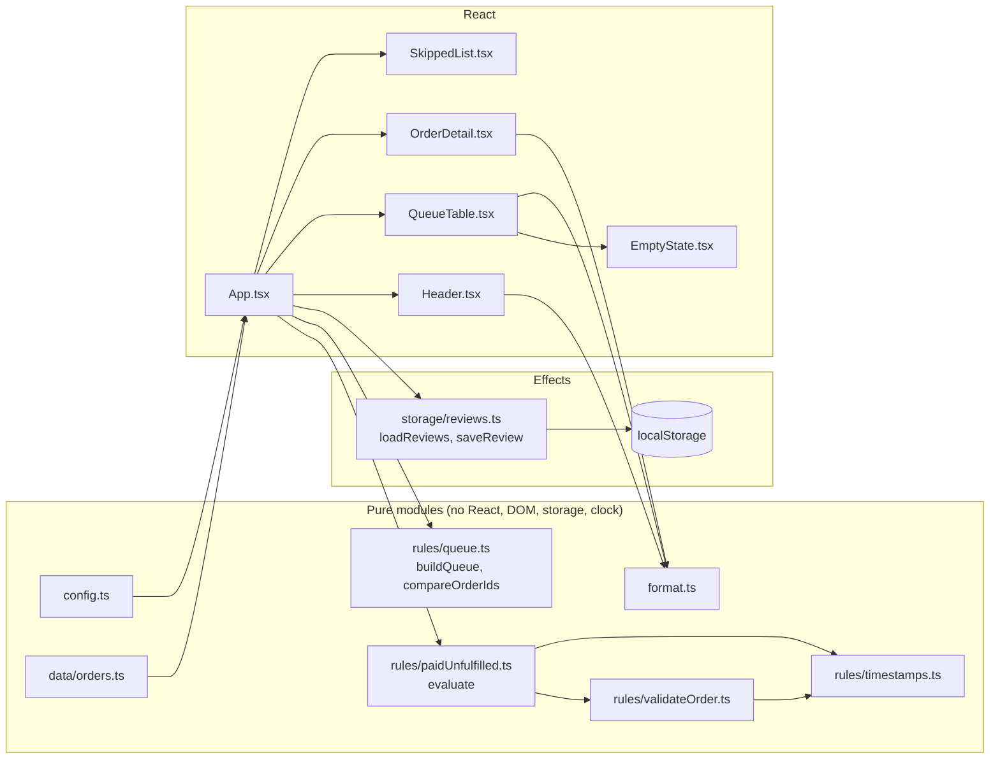
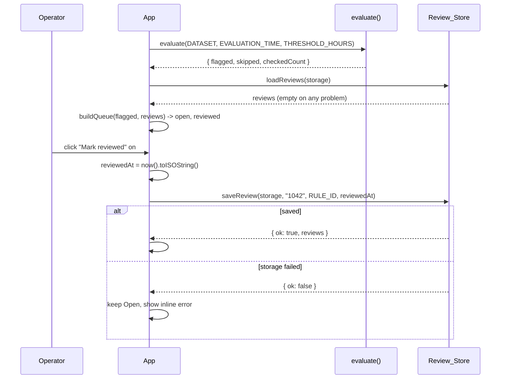

# Design Document

## Overview

Fulfillment Watch (Stage A) is a client-only React 19 and TypeScript single-page app. It evaluates a bundled synthetic dataset of 12 to 20 orders against one rule, "Paid and unfulfilled", at a fixed evaluation time (`2026-11-20T12:00:00Z`), shows the flagged orders in an Open and a Reviewed queue, and lets the operator record a review. Review records are the only thing the app writes, and only to browser local storage.

The design follows the layering in `.kiro/steering/structure.md` and `tech.md`:

- A pure **Evaluator** (`src/rules/`) validates and evaluates orders. It imports nothing from React, the DOM, storage, or the clock.
- A small **Review_Store** (`src/storage/reviews.ts`) wraps local storage and never throws.
- **Components** (`src/components/`) render state and call the two modules above. `App.tsx` composes them.

Key design decisions:

| Decision | Rationale |
| --- | --- |
| Evaluator takes `evaluationTime` (ISO string) and `thresholdHours` as arguments | Req 1.2, 8.1, 8.6. Tests run it directly with no clock. |
| Dataset is typed as `RawOrder` (`Record<string, unknown>`), not `Order` | The dataset deliberately contains malformed records (Req 1.5, 6). Validation turns a `RawOrder` into a typed `Order` or a `SkippedRecord`. |
| Review_Store takes a `StorageLike` argument (or `null`) instead of touching `window.localStorage` | Tests inject an in-memory fake, a throwing fake, and `null` without jsdom globals (Req 8.7 to 8.9). |
| The review timestamp is created in the click handler in `App.tsx` and passed to `saveReview` as a string | Req 5.9, 8.9. The store has no clock access. |
| Duplicate order IDs are detected against previously **accepted** orders only | A skipped record then never changes the outcome for any other record (Req 6.5), including when an earlier record with the same ID was itself invalid. This reads "keep the first Order with that ID" (Req 6.9) as "the first valid one". |
| Reviews are loaded all-or-nothing | Any entry that fails validation makes the store return no reviews (Req 5.5). A single corrupt entry is not worth a partial-trust code path, because only this app writes the key. |
| Review keys are `JSON.stringify([orderId, ruleId])` | Avoids collisions from a delimiter inside an ID. |
| Hours are whole numbers rounded down using integer millisecond arithmetic | Req 3.8, 4.1. The threshold comparison uses milliseconds (`elapsedMs >= thresholdHours * 3_600_000`), so exactly 24 h is flagged and 23 h 59 min is not. |

### Research notes

No external research was needed. The design depends on well-known platform behavior:

- `Date.parse` on an ISO string without a zone designator is interpreted as local time, which would break UTC rules. The timestamp parser therefore requires a trailing `Z` and checks the calendar fields itself.
- Reading `window.localStorage` can throw (blocked storage, privacy modes), not only `getItem` and `setItem`. The browser-storage accessor therefore wraps the property access in `try/catch` too.

### Dependencies to add (dev only)

| Package | Why | Status |
| --- | --- | --- |
| `vitest` (a release that supports Vite 8) | Test runner. Add `"test": "vitest"` to `package.json` so `npm test -- --run` runs one pass (Req 8.2, 8.3). | Approved by the user |
| `fast-check` | Property-based testing library. Property tests must not be hand-rolled. | Needs user approval |
| `jsdom`, `@testing-library/react`, `@testing-library/user-event` | Component tests for reload, corrupt storage, keyboard use, and empty-state announcements (Req 8.7, 8.8, 9). Component test files select jsdom with a `// @vitest-environment jsdom` docblock, so `vite.config.ts` stays unchanged. | Needs user approval |

If the user declines the last two rows, the Evaluator, Review_Store, queue, and format tests still run in Vitest's default node environment. Only the component tests for Req 8.7, 8.8, and 9 would be lost, and the same behavior would then be covered by tests on `App`-level pure helpers only.

## Architecture



Dependency rule: `rules/*` and `format.ts` import only from `types.ts` and each other. `storage/reviews.ts` imports only `types.ts`. Components import from the pure modules and `types.ts`, never from `storage/`. Only `App.tsx` talks to the Review_Store.

### Runtime flow



The app issues no network requests. `index.html` and the bundle are the only loads (Req 7.1).

## Components and Interfaces

### `src/config.ts`

```ts
export const EVALUATION_TIME = '2026-11-20T12:00:00Z';
export const DEFAULT_THRESHOLD_HOURS = 24;
export const RULE_ID = 'paid-unfulfilled';
export const RULE_NAME = 'Paid and unfulfilled';
export const SUGGESTED_ACTION = 'Confirm pick status with the warehouse.';
export const REVIEW_STORAGE_KEY = 'fulfillment-watch.reviews.v1';
```

### `src/types.ts`

```ts
export type RawOrder = Readonly<Record<string, unknown>>;

export type RefundStatus = 'none' | 'partial' | 'full';

export interface Order {
  readonly orderId: string;
  readonly paymentStatus: string;      // as supplied; compared after trim + lowercase
  readonly paidAtMs: number;           // parsed UTC epoch milliseconds
  readonly paidAt: string;             // original ISO string, for display
  readonly canceled: boolean;
  readonly refundStatus: RefundStatus;
  readonly orderedQuantity: number;
  readonly fulfilledQuantity: number;
}

export interface FlaggedOrder {
  readonly order: Order;
  readonly elapsedMs: number;
}

export type SkipCode =
  | 'missing-field'
  | 'invalid-timestamp'
  | 'future-timestamp'
  | 'invalid-quantity'
  | 'invalid-refund-status'
  | 'duplicate-order-id';

export interface SkipReason {
  readonly code: SkipCode;
  readonly field?: string;             // the field a reason is about, when there is one
  readonly message: string;            // shown in the skipped list
}

export interface SkippedRecord {
  readonly orderId: string | null;     // null when the ID itself is missing
  readonly index: number;              // position in the input, to tell apart records without an ID
  readonly reasons: readonly SkipReason[];   // one entry per failure found, at least one
}

export interface EvaluationResult {
  readonly flagged: readonly FlaggedOrder[];   // sorted per Req 3.2
  readonly skipped: readonly SkippedRecord[];  // input order
  readonly checkedCount: number;               // total records received, including skipped
}

export interface ReviewRecord {
  readonly orderId: string;
  readonly ruleId: string;
  readonly reviewedAt: string;                 // ISO 8601 UTC, ends in Z
}

export type ReviewMap = ReadonlyMap<string, ReviewRecord>;   // key: reviewKey(orderId, ruleId)
```

### `src/rules/timestamps.ts`

```ts
export function parseUtcTimestamp(value: unknown): number | null;
```

Accepts only a string matching `YYYY-MM-DDTHH:MM[:SS[.fff]]Z`. It then builds the value with `Date.UTC` from the parsed fields and rejects the input when the resulting date does not round-trip to the same year, month, day, hour, and minute (so `2026-02-30T00:00:00Z` is invalid). It returns epoch milliseconds, or `null` for anything else. It never throws and never reads the clock.

### `src/rules/validateOrder.ts`

```ts
export type ValidationResult =
  | { readonly ok: true; readonly order: Order }
  | { readonly ok: false; readonly reasons: readonly SkipReason[] };

export function validateOrder(raw: RawOrder, evaluationTimeMs: number): ValidationResult;
```

Checks every field and collects **all** failures (Req 6.6), in this order of fields: `orderId`, `paymentStatus`, `paymentTimestamp`, `canceled`, `refundStatus`, `orderedQuantity`, `fulfilledQuantity`.

| Field | Missing when | Invalid when |
| --- | --- | --- |
| `orderId` | absent, not a string, or empty after trim | n/a |
| `paymentStatus` | absent, not a string, or empty after trim | n/a |
| `paymentTimestamp` | absent, `null`, or empty string | `parseUtcTimestamp` returns `null` (`invalid-timestamp`), or parsed value is greater than `evaluationTimeMs` (`future-timestamp`). Equal is valid (Req 6.4). |
| `canceled` | absent or `null` | not a boolean. No default is assumed (Req 6.2). Reported as `missing-field`. |
| `refundStatus` | absent | not `none`, `partial`, or `full` (`invalid-refund-status`, Req 6.10) |
| `orderedQuantity`, `fulfilledQuantity` | absent | not a non-negative safe integer (`invalid-quantity`, naming each bad field, Req 6.3) |

A missing field is reported with code `missing-field` and the field name, so a record missing several fields lists each one (Req 6.2). Validation does not depend on payment status, so unpaid records that are malformed are skipped too (Req 6.12).

### `src/rules/paidUnfulfilled.ts`

```ts
export function evaluate(
  orders: readonly RawOrder[],
  evaluationTime: string,
  thresholdHours: number,
): EvaluationResult;
```

Algorithm:

1. Parse `evaluationTime` with `parseUtcTimestamp`. If it is invalid, throw a `RangeError`. This is a programmer error, because the value is a constant (see Error Handling).
2. Iterate `orders` in order, keeping a `Set` of accepted order IDs.
3. For each record, call `validateOrder`. When it fails, add a `SkippedRecord`. When it passes but its ID is already in the set, add a `SkippedRecord` with a `duplicate-order-id` reason. Otherwise add the ID to the set and test the rule.
4. Rule test on an accepted `Order`: `paymentStatus.trim().toLowerCase() === 'paid'` and `elapsedMs >= thresholdHours * 3_600_000` (where `elapsedMs = evaluationTimeMs - paidAtMs`) and `fulfilledQuantity === 0` and `!canceled` and `refundStatus !== 'full'`. A pass becomes a `FlaggedOrder`. A fail is dropped silently (excluded, not skipped).
5. Sort `flagged` with `compareFlagged` from `queue.ts` and return `{ flagged, skipped, checkedCount: orders.length }`.

The function does not mutate its inputs and has no other inputs (Req 2.9, 7.3, 8.1). An empty array returns empty results with `checkedCount` 0 (Req 1.8).

### `src/rules/queue.ts`

```ts
export function compareOrderIds(a: string, b: string): number;
export function compareFlagged(a: FlaggedOrder, b: FlaggedOrder): number;
export function reviewKey(orderId: string, ruleId: string): string;
export interface QueueRow { readonly flagged: FlaggedOrder; readonly review: ReviewRecord | null }
export function buildQueue(
  flagged: readonly FlaggedOrder[],
  reviews: ReviewMap,
  ruleId: string,
): { readonly open: readonly QueueRow[]; readonly reviewed: readonly QueueRow[] };
```

- `compareOrderIds`: when both IDs are all digits, compare them numerically without precision loss (strip leading zeros, compare length, then compare text). When the numeric values are equal, or when either ID is not all digits, compare as text with `<` and `>` (code-unit order, locale independent). The text fallback keeps the order total and deterministic.
- `compareFlagged`: earlier `paidAtMs` first, then `compareOrderIds` (Req 3.2).
- `buildQueue`: for each flagged order, look up `reviewKey(orderId, ruleId)`. A found record puts the row in `reviewed`, otherwise in `open`. Input order is preserved, so both lists stay sorted. Reviews for orders that are not flagged are ignored here and stay in the map untouched (Req 5.7, 5.8).

### `src/format.ts`

```ts
export function formatHours(elapsedMs: number): string;               // "27 h"       (floor)
export function formatElapsed(elapsedMs: number): string;            // "27 h 0 min"
export function formatReason(f: FlaggedOrder, thresholdHours: number): string;
//   "Paid 27 h ago, 0 of 2 units fulfilled (threshold 24 h)"
export function formatUtc(isoOrMs: string | number): string;         // "2026-11-20 12:05 UTC"
export function formatOrderId(orderId: string): string;              // "#1042"
export function formatCounts(checked: number, skipped: number): string; // "17 checked, 5 skipped"
```

All are pure and format with UTC getters only (`getUTC*`), so output does not depend on the browser's time zone.

### `src/storage/reviews.ts`

```ts
export interface StorageLike {
  getItem(key: string): string | null;
  setItem(key: string, value: string): void;
}

export function getBrowserStorage(): StorageLike | null;   // wraps window.localStorage access in try/catch

export function loadReviews(storage: StorageLike | null): ReviewMap;

export type SaveResult =
  | { readonly ok: true; readonly reviews: ReviewMap }
  | { readonly ok: false; readonly reviews: ReviewMap; readonly error: string };

export function saveReview(
  storage: StorageLike | null,
  orderId: string,
  ruleId: string,
  reviewedAt: string,
): SaveResult;
```

Behavior:

- **Format on disk:** one key, `REVIEW_STORAGE_KEY`, holding a JSON array of `{ orderId, ruleId, reviewedAt }`. Nothing else is written (Req 7.2).
- **`loadReviews`:** returns an empty map when `storage` is `null`, the key is absent, `getItem` throws, the JSON does not parse, the value is not an array, or **any** entry is not an object with string `orderId`, string `ruleId`, and a `reviewedAt` accepted by `parseUtcTimestamp`. It never throws (Req 5.5). Duplicate keys in the stored array keep the first entry.
- **`saveReview`:** loads current reviews. When the key already exists, it returns `{ ok: true, reviews }` with the existing record unchanged and does not write (Req 5.2). Otherwise it adds the record, writes the full array with `setItem`, and returns the new map. If `storage` is `null` or `setItem` throws, it returns `{ ok: false, reviews: <map before the attempt>, error }`. `saveReview` does not read the clock; `reviewedAt` is always an argument (Req 5.9).

### React components

All components are function components in their own `PascalCase.tsx` file and export only the component.

| Component | Props | Responsibility |
| --- | --- | --- |
| `App` | `dataset?: readonly RawOrder[]`, `storage?: StorageLike \| null`, `now?: () => Date` (defaults: bundled dataset, `getBrowserStorage()`, `() => new Date()`) | Holds state: `result` (evaluation), `reviews`, `view` (`'open'` or `'reviewed'`), `selectedId`, `saveError`, `skippedOpen`. Runs `evaluate` once on mount and again on re-run. Computes `buildQueue` on each render. Handles "Mark reviewed" using `now().toISOString()`. Clears `selectedId` when the selected order is no longer flagged. |
| `Header` | `checkedCount`, `skippedCount`, `evaluationTime`, `onRerun`, `onOpenSkipped` | Shows "17 checked, 5 skipped" (Req 1.3), the evaluation time in UTC, the **Re-run evaluation** button (Req 1.7), and the "N skipped" button (Req 6.7, 6.8). |
| `QueueTable` | `rows`, `view`, `selectedId`, `onSelect`, `onMarkReviewed`, `thresholdHours` | A `<table>` with `<th scope="col">` headers: Order, Hours since payment, Reason, Review status, Action. The order cell holds a `<button>` showing `#1042` that selects the row, with `aria-current="true"` when selected. The Action cell holds a "Mark reviewed" `<button>` in the Open view and nothing in the Reviewed view (Req 5.11). Renders `EmptyState` instead of the table body when `rows` is empty. |
| `EmptyState` | `message` | `<p role="status">` so screen readers announce it (Req 9.4). Open: "No stalled orders. Nothing needs review." Reviewed: "No reviewed orders yet." |
| `OrderDetail` | `flagged`, `review` | Shows payment timestamp (UTC), elapsed ("27 h 0 min"), "0 of 2 units fulfilled", rule name "Paid and unfulfilled", and the suggested action (Req 4.1). Read-only (Req 4.4). |
| `SkippedList` | `skipped`, `onClose` | A table of order ID (or "(no ID)" plus the input position) and the reasons for each record. |

The view switch is two `<button>`s ("Open", "Reviewed") with `aria-pressed`. Both are real buttons, so keyboard use is native (Req 9.1, 9.2). A save failure renders `<p role="alert">` above the table (Req 5.12).

### Bundled dataset (`src/data/orders.ts`)

17 records (within 12 to 20, Req 1.4), all synthetic, written as `RawOrder` literals so invalid ones can be malformed. `now` is the fixed `2026-11-20T12:00:00Z`.

| Order ID | Payment status | Paid at (UTC) | Canceled | Refund | Ordered / fulfilled | Expected outcome | Covers |
| --- | --- | --- | --- | --- | --- | --- | --- |
| 998 | paid | 2026-11-19T09:00:00Z | false | none | 1 / 0 | Flagged, 27 h, sorts before 1042 (same timestamp, numeric ID order) | Req 3.2, 3.11 |
| 1042 | paid | 2026-11-19T09:00:00Z | false | none | 2 / 0 | Flagged, 27 h 0 min | BRD row 3 |
| 1043 | paid | 2026-11-19T12:00:00Z | false | none | 1 / 0 | Flagged, exactly 24 h | BRD row 2 |
| 1044 | paid | 2026-11-19T12:01:00Z | false | none | 1 / 0 | Excluded, 23 h 59 min | BRD row 1 |
| 1045 | paid | 2026-11-18T08:00:00Z | true | none | 1 / 0 | Excluded, canceled | BRD row 4 |
| 1046 | paid | 2026-11-18T09:00:00Z | false | full | 1 / 0 | Excluded, fully refunded | BRD row 4 |
| 1047 | pending | 2026-11-18T10:00:00Z | false | none | 1 / 0 | Excluded, unpaid (not skipped) | BRD row 5 |
| 1048 | paid | 2026-11-18T11:00:00Z | false | none | 3 / 1 | Excluded, units fulfilled | BRD row 5 |
| 1049 | paid | 2026-11-18T10:00:00Z | false | partial | 2 / 0 | Flagged, partial refund | Req 2.8 |
| 1050 | " PAID " | 2026-11-19T06:30:00Z | false | none | 1 / 0 | Flagged, status normalized | Req 2.10 |
| 1051 | paid | 2026-11-16T15:00:00Z | false | none | 4 / 0 | Flagged, oldest | Req 3.2 |
| 1052 | paid | 2026-11-20T12:00:00Z | false | none | 1 / 0 | Excluded, 0 h, valid and not skipped | Req 6.4 |
| 1053 | paid | `"yesterday"` | false | none | 1 / 0 | Skipped, invalid timestamp | BRD row 6 |
| 1054 | paid | 2026-11-21T00:00:00Z | false | none | 1 / 0 | Skipped, later than evaluation time | Req 6.1 |
| 1055 | paid | 2026-11-18T09:00:00Z | false | none | 2 / -1 | Skipped, invalid quantity | Req 6.3 |
| 1056 | paid | (missing) | false | none | 1 / 0 | Skipped, missing timestamp | Req 6.1 |
| 1043 (second record) | paid | 2026-11-18T09:00:00Z | false | none | 1 / 0 | Skipped, duplicate order ID | Req 6.9 |

Result at load: "17 checked, 5 skipped". Six orders are flagged and sorted: #1051, #1049, #1050, #998, #1042, #1043. Order #1042 matches the BRD example.

## Data Models

### Review record

```json
[{ "orderId": "1042", "ruleId": "paid-unfulfilled", "reviewedAt": "2026-11-20T12:05:31.000Z" }]
```

Stored under `fulfillment-watch.reviews.v1`. The `v1` suffix lets a later schema change ignore old data instead of mis-reading it. The in-memory form is a `Map` keyed by `reviewKey(orderId, ruleId)`, which makes "one record per key" structural.

### Derived state

- `result: EvaluationResult` comes from `evaluate`. It is recomputed only on mount and on re-run. Because the dataset and time are constants, a re-run yields an identical result (Req 5.6).
- `{ open, reviewed } = buildQueue(result.flagged, reviews, RULE_ID)` is computed on render and holds no state of its own, so an order that stops matching leaves both views with no cleanup, and its `reviews` entry stays (Req 5.7).
- Order data is never copied into storage or edited. All types are `readonly` (Req 7.3).

### Display formats

| Value | Format | Example |
| --- | --- | --- |
| Hours in the queue | `floor(elapsedMs / 3_600_000)` + " h" | `27 h` |
| Elapsed in detail | whole hours, then whole minutes of the remainder | `27 h 0 min` |
| UTC time | `YYYY-MM-DD HH:mm UTC`, seconds dropped | `2026-11-20 12:05 UTC` |
| Order ID | `#` + ID | `#1042` |

## Correctness Properties

Correctness properties are characteristics or behaviors that should hold true across all valid executions of a system. Each is a formal statement about what the system should do, and together they bridge human-readable specifications and machine-verifiable correctness guarantees.

Reflection on the prework: it produced many per-clause properties for the rule (fulfilled units, canceled, full refund, unpaid, partial refund, status normalization). They collapse into one model-based property (Property 2). The skip-reason clauses (missing fields, bad timestamp, bad quantity, bad refund status, unpaid-but-invalid, multiple failures) collapse into Property 3. Properties for "Open shows only unreviewed", "Reviewed shows only reviewed", "reload keeps reviews", and "stale reviews are kept" collapse into Property 8. The "keep first review" property covers both Req 5.2 and 8.9. Criteria about layout, wording, keyboard use, and wiring are example tests, listed in the Testing Strategy.

### Property 1: Evaluation is deterministic and does not mutate its input

For any array of raw orders (valid and malformed, possibly empty), any evaluation time, and any threshold, calling `evaluate` twice returns deeply equal results, and the input array and its records are deeply equal to a clone taken before the first call.

**Validates: Requirements 1.2, 2.9, 7.3**

### Property 2: The flag decision matches the rule

For any array of valid orders with unique IDs and any threshold, an order appears in `flagged` if and only if its payment status, after trimming and lowercasing, equals `paid`, its elapsed milliseconds are at least `threshold * 3_600_000`, its fulfilled quantity is 0, it is not canceled, and its refund status is not `full`. Every valid order that is not flagged is absent from `skipped`. Generators bias payment times to the boundary offsets of exactly the threshold, one minute under, and zero elapsed time.

**Validates: Requirements 2.1, 2.2, 2.3, 2.4, 2.5, 2.6, 2.7, 2.8, 2.10, 2.11, 6.4, 8.10**

### Property 3: Invalid records are skipped once, with a reason per defect

For any valid order and any non-empty set of injected defects (removing fields, an unparsable, empty, or later-than-evaluation-time payment timestamp, a negative, fractional, or non-numeric quantity, a refund status outside `none`, `partial`, `full`, and any payment status including unpaid), `evaluate` returns the record exactly once in `skipped`, never in `flagged`, with at least one reason for each injected defect, and with each missing field named in the reasons. `checkedCount` equals the length of the input array.

**Validates: Requirements 1.3, 6.1, 6.2, 6.3, 6.6, 6.10, 6.11, 6.12**

### Property 4: Skipped records do not affect other records

For any array of raw orders, removing every record that `evaluate` reports as skipped produces an input whose `flagged` result equals the `flagged` result of the original input.

**Validates: Requirements 6.5**

### Property 5: Duplicate IDs keep the first, and flagged IDs are unique

For any array of raw orders, the order IDs in `flagged` are pairwise distinct, and for any valid order followed later by another record with the same ID, the first is evaluated and the later one appears in `skipped` with a `duplicate-order-id` reason.

**Validates: Requirements 5.6, 6.9**

### Property 6: Queue order is earliest payment first, then natural ID

For any array of raw orders, every adjacent pair in `flagged` satisfies `paidAtMs` ascending, and for equal `paidAtMs`, `compareOrderIds` is not positive.

**Validates: Requirements 3.2**

### Property 7: Order ID comparison is a consistent total order

For any three order IDs, `compareOrderIds` is antisymmetric (`sign(compare(a, b)) === -sign(compare(b, a))`), transitive, and returns 0 only for identical strings. For any two all-digit IDs of any length, the result matches numeric order.

**Validates: Requirements 3.11**

### Property 8: The queue partitions flagged orders by saved review

For any list of flagged orders and any review map, `buildQueue` puts each flagged order in exactly one of `open` or `reviewed`, with `reviewed` holding exactly the orders that have a review for the rule, each row carrying the stored review (including its original timestamp), and both lists keeping the input order. Review records for orders not in the flagged list appear in neither list, and the review map is unchanged. Passing a later flagged list that contains such an order again puts it in `reviewed` with the same timestamp.

**Validates: Requirements 3.4, 3.5, 5.3, 5.7, 5.8**

### Property 9: Review round trip

For any sequence of review records with distinct (orderId, ruleId) keys and valid UTC timestamps, saving each with `saveReview` and then calling `loadReviews` on the same storage returns a map holding exactly those records with equal `orderId`, `ruleId`, and `reviewedAt`.

**Validates: Requirements 5.4**

### Property 10: A second review keeps the first

For any order ID, rule ID, and two timestamps, saving a review twice leaves exactly one record for that key whose `reviewedAt` is the first timestamp, and the second call reports success without writing.

**Validates: Requirements 5.2, 8.9**

### Property 11: Bad storage never breaks loading

For any string stored under the review key (including invalid JSON, non-arrays, arrays with malformed entries, and entries with unparsable timestamps), and for storage that is `null` or whose `getItem` throws, `loadReviews` returns an empty map without throwing. For storage whose `setItem` throws, `saveReview` returns `ok: false` and the reviews it reports equal those loaded before the call.

**Validates: Requirements 5.5, 5.12**

### Property 12: Duration and reason text agree with the elapsed time

For any non-negative `elapsedMs`, `formatHours` equals `floor(elapsedMs / 3_600_000)` followed by ` h`. `formatElapsed` shows the same whole hours and a minutes value equal to `floor((elapsedMs mod 3_600_000) / 60_000)`. For any flagged order and threshold, `formatReason` equals `Paid {hours} h ago, {fulfilled} of {ordered} units fulfilled (threshold {threshold} h)` built from that order's own values.

**Validates: Requirements 3.8, 3.9, 4.1**

### Property 13: UTC timestamps format in UTC regardless of time zone

For any valid instant, `formatUtc` returns `YYYY-MM-DD HH:mm UTC` whose fields equal the instant's UTC fields, and the result is the same under any process time zone.

**Validates: Requirements 5.10**

## Error Handling

| Situation | Handling |
| --- | --- |
| Malformed order record | Never throws. `validateOrder` returns reasons, and `evaluate` adds a `SkippedRecord` and continues (Req 6.5). |
| `evaluationTime` argument is unparsable | `evaluate` throws `RangeError`. This is a programmer error, since the value is the constant in `config.ts`, and failing loudly beats silently flagging nothing. Covered by one unit test. |
| Local storage is blocked, missing, or throws on access | `getBrowserStorage` returns `null`. `loadReviews(null)` returns no reviews. All matching orders show as Open (Req 5.5). |
| Stored review data is corrupt | `loadReviews` returns no reviews. The next successful save overwrites the key with a valid array. |
| `setItem` throws (quota, blocked) | `saveReview` returns `ok: false`. `App` keeps the order Open, shows a `role="alert"` message ("Could not save the review. The order stays open."), and stays usable (Req 5.12). The message clears on the next successful save. |
| Selected order no longer flagged after re-run | `App` clears `selectedId` and the detail pane. |
| Empty dataset | Empty queue states, header "0 checked, 0 skipped" (Req 1.8). |
| Unexpected render error | Not handled specially in Stage A. There is no network or async code that could fail late. |

## Testing Strategy

PBT applies to the Evaluator, queue, format, and Review_Store modules. These are pure or take injected dependencies, and their behavior varies meaningfully with input. It does not apply to the React components, which get example-based tests, or to the bundled dataset and config, which get smoke checks.

### Dual approach

- **Property tests** (`fast-check` with Vitest): Properties 1 to 13 above. Each runs at least 100 iterations (`fc.assert(..., { numRuns: 100 })` or higher). Each property is implemented as a single property-based test, tagged with a comment in the form `Feature: stalled-orders, Property {n}: {title}`.
- **Unit and example tests**: specific scenarios, boundaries, and integration points.

Tests live next to the code as `*.test.ts` or `*.test.tsx` and always pass the evaluation time and the review timestamp as arguments. No test calls `Date.now()` or `new Date()` without an argument (Req 8.6). Data is synthetic only.

### Test files

| File | Contents |
| --- | --- |
| `src/rules/paidUnfulfilled.test.ts` | BRD success table tests named by row, Properties 1 to 5, empty dataset, unparsable evaluation time |
| `src/rules/timestamps.test.ts` | Valid and invalid UTC strings, calendar edge cases (Feb 30, missing `Z`, offsets) |
| `src/rules/queue.test.ts` | Properties 6, 7, 8 |
| `src/format.test.ts` | Properties 12, 13, plus examples for `#` prefix and counts |
| `src/storage/reviews.test.ts` | Properties 9, 10, 11, only-one-key-written check (Req 7.2) |
| `src/data/orders.test.ts` | Smoke: 12 to 20 records, evaluation yields the expected flagged list and "17 checked, 5 skipped" |
| `src/App.test.tsx` | jsdom component tests (below) |

### BRD success table, one named test per row (Req 8.4)

1. `Paid 23 hours 59 minutes ago, zero fulfilled: Stays out of the queue`
2. `Paid exactly 24 hours ago, zero fulfilled: Appears in Open`
3. `Order #1042, paid 27 hours ago, 0 of 2 fulfilled: Appears with elapsed time, reason, and suggested action`
4. `Paid more than 24 hours ago, canceled or fully refunded: Stays out, even when payment status still reads paid`
5. `Unpaid order, or any units fulfilled: Stays out`
6. `Payment timestamp is invalid: Record is skipped and counted; valid orders still evaluate`
7. `Operator marks #1042 reviewed and reloads: #1042 remains in Reviewed with its timestamp` (component test, unmount and re-render with the same fake storage)
8. `Same data evaluated twice: One row per matching order and rule`
9. `A flagged order is later fulfilled: It leaves the queue after re-evaluation`

### Component tests (`App.test.tsx`, jsdom)

Use an in-memory `StorageLike` fake and an injected `now`. Cover: initial load and header text (Req 1.1, 1.3); re-run (1.7); empty datasets and both empty-state messages with `role="status"` (1.8, 3.6, 3.7, 9.4); row content and `#` prefix (3.1, 3.10); selecting a row and replacing detail (4.1 to 4.4); Mark reviewed with the injected timestamp, hidden in Reviewed (5.1, 5.9, 5.11); reload (5.3, 8.7); corrupt, throwing, and `null` storage (5.5, 8.8); save failure shows `role="alert"` and the order stays Open (5.12); skipped summary and list (6.7, 6.8); keyboard-only select and review with `user-event` (9.1, 9.2); table and column header roles (9.3); no `fetch` or `XMLHttpRequest` calls during load and actions (7.1).

### Other checks

- **Smoke:** a test that reads `src/rules/*.ts` and `src/format.ts` source text and asserts no import from `react`, `react-dom`, `../storage`, or `../components`, and no `Date.now`, `new Date(`, `localStorage`, or `document` (Req 8.1). `npm run scan:secrets` covers Req 7.4.
- **Commands:** `npm test -- --run` for tests (needs the `"test": "vitest"` script), and `npm run check` for lint, secrets, and SAST.
- **Follow-up:** update the Vitest lines in `.kiro/steering/testing.md` and `tech.md` after adding the dependency (Decision Q17). The steering files currently say to use `npx vitest --run`.
