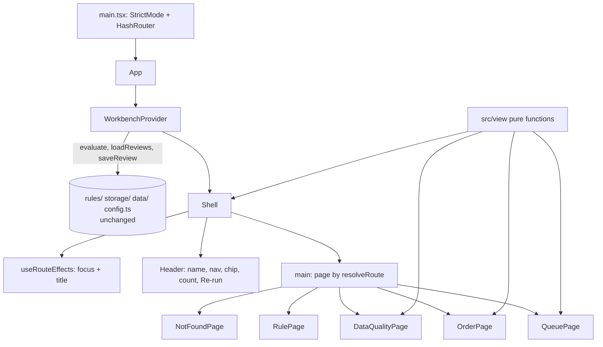

# Design Document

## Overview

This design implements the Stage A.1 redesign in `requirements.md`. The Workbench becomes a light, multi-page single-page app with hash routes: an app shell, a Queue page (Open and Reviewed), an Order page, a Data quality page and a Rule page. Presentation and navigation change. The Evaluator, the Review_Store and the Dataset do not.

Constraints that shape the design:

- `src/rules/`, `src/storage/` and `src/data/` stay byte-identical (Req 14.1). All new logic lives in new files outside those directories.
- `react-router-dom` is the only new runtime dependency, pinned to an exact version (Req 1.7). Latest at design time is `7.18.6`; its peer range is `react >=18` and it needs Node 20 or newer ([npm registry](https://www.npmjs.com/package/react-router-dom)). Tasks must re-check the version and write it without `^` or `~`.
- Styling is plain CSS with variables from `src/styles/tokens.css` and inline SVG icons (Req 11, `.kiro/steering/ui-style.md`).
- Product rules from `.kiro/steering/product.md` hold: read-only toward orders, fixed evaluation time `2026-11-20T12:00:00Z`, synthetic data only. The real clock is used only for the review timestamp, as in Stage A (`now` prop on `App`).

### Key design decisions

| Decision | Rationale |
| --- | --- |
| One pure function `resolveRoute(pathname)` is the single source of truth for page selection, nav `aria-current`, and page names. `App` renders the page with a `switch` on its result instead of `<Routes>`. | Req 1, 2.4, 2.5, 3. Page mapping becomes a total pure function that property tests can cover. `HashRouter` still supplies location and `Link`. |
| `HashRouter` is created in `main.tsx`. `App` does not create a router and uses `useLocation`. Tests wrap `App` in `MemoryRouter`. | Req 1.2 to 1.4. Tests set the route without touching `window.location`. `main.tsx` passes through the same `App` props as Stage A. |
| Shared state (evaluation result, reviews, save error, re-run, mark reviewed) lives in `WorkbenchProvider`, reached through a `useWorkbench` hook. | The Shell Re-run control (Req 2.8), the Queue page and the Order page all use the same state, so a review made on one page shows on the others (Req 7.3, 8.6). |
| The context object and hook live in `src/state/workbenchContext.ts`. The provider component lives in `src/state/WorkbenchProvider.tsx`. | `code-style.md` allows only components to be exported from `.tsx` files (react-refresh). |
| Derived values (age tier, summary, skipped groups, route mapping, progress fraction) are pure functions in `src/view/`. | They are testable as properties without React. They call the existing `formatHours`, `formatElapsed`, `formatUtc`, `formatOrderId`, `formatCounts`, `buildQueue` and `evaluate`. Nothing from those is reimplemented. |
| Skipped records are grouped by the reason `message` text, as recorded by the Evaluator. | Req 9.7 requires the reason text unchanged. The Evaluator gives each skip reason a `message`. One message, such as the duplicate ID message, embeds the order ID, so duplicate-ID records for different IDs form separate groups. This follows Req 9.1 ("distinct reason") literally. |
| Media queries use `em` units, such as `48em` for 768 px. | CSS variables cannot be used in media queries, and Req 11.2 forbids hard-coded pixel values in component stylesheets. |
| Focus and title are handled in one `RouteEffects` hook keyed on `pathname`. The title is read from the rendered `h1`. | Req 3.3 requires the title to equal the `h1` text. Reading the `h1` guarantees it. Keying on `pathname` gives Req 3.6. |
| The queue table stays a real `table` element on all widths. On narrow screens CSS turns rows into stacked cards, using a `data-label` attribute on each `td`. | Req 6.8, 13.2, 13.3. One markup, no duplicated JSX. |
| The save error is stored as the order ID that failed (`saveErrorFor: string \| null`). | The Queue page shows the Stage A message when any save fails. The Order page shows it only for its own order (Req 7.5, 8.7). |

### Research notes

- `HashRouter` keeps the route after `#` and works without server rewrites, which suits the existing static `base: '/absproxy/5173/'` in `vite.config.ts`. See [React Router HashRouter](https://reactrouter.com/api/declarative-routers/HashRouter).
- Whether `useLocation().pathname` returns an encoded or decoded path for IDs with special characters differs between router versions. `resolveRoute` therefore decodes with `decodeURIComponent` inside a `try/catch`, and `orderPath` always encodes. A malformed escape resolves to the Not_Found_Page. This must be confirmed in the browser during verification.
- Contrast is checked on the token pairs by a test that computes the WCAG ratio from `tokens.css` values, so Req 11.7 does not rely on a manual check.

## Architecture



### File layout

New and changed files. Files in `src/rules/`, `src/storage/`, `src/data/`, `src/config.ts`, `src/types.ts` and `src/format.ts` are not changed. If a new constant is needed it goes in a new file, not `config.ts`.

```
src/
├── main.tsx                         # changed: wrap App in HashRouter
├── App.tsx                          # changed: provider + shell + page switch
├── App.css                          # changed: layout only, tokens only
├── index.css                        # changed: import tokens, base styles
├── styles/tokens.css                # new: all colors, spacing, radii, type sizes
├── state/
│   ├── workbenchContext.ts          # new: context, useWorkbench
│   └── WorkbenchProvider.tsx        # new: state, rerun, markReviewed
├── view/                            # new: pure view logic, no React
│   ├── routes.ts                    # resolveRoute, orderPath, navCurrent, ROUTE_PATHS
│   ├── age.ts                       # ageTier, ageLabel
│   ├── summary.ts                   # summarize
│   ├── skipped.ts                   # groupSkippedByReason, skippedLabel
│   ├── progress.ts                  # progressFraction
│   └── title.ts                     # documentTitle
├── hooks/useRouteEffects.ts         # new: focus + title on route change
├── components/
│   ├── Header.tsx                   # changed: name, nav, chip, count, Re-run
│   ├── NavBar.tsx                   # new
│   ├── SummaryCards.tsx             # new
│   ├── QueueTabs.tsx                # new
│   ├── QueueTable.tsx               # changed: links, chips, stacked cards
│   ├── AgeChip.tsx, StatusChip.tsx  # new
│   ├── Icon.tsx                     # new: inline SVG set
│   ├── EvidencePanel.tsx            # new (from OrderDetail)
│   ├── NextCheckBox.tsx             # new
│   ├── SkippedGroups.tsx            # replaces SkippedList
│   ├── EmptyState.tsx               # unchanged
│   └── OrderDetail.tsx, SkippedList.tsx  # removed after their tests are moved
└── pages/
    ├── QueuePage.tsx, OrderPage.tsx, DataQualityPage.tsx,
    └── RulePage.tsx, NotFoundPage.tsx
```

`structure.md` lists a flat `components/` folder. The `pages/`, `view/`, `state/` and `hooks/` folders are additions, and the tasks should update `structure.md`.

### Reuse of existing code

| Existing code | Used for |
| --- | --- |
| `evaluate(dataset, EVALUATION_TIME, DEFAULT_THRESHOLD_HOURS)` | Provider state, unchanged call from Stage A `App.tsx`. |
| `buildQueue(flagged, reviews, RULE_ID)` | Open and Reviewed rows. It preserves the sorted input order, so Req 6.2 needs no new sorting. |
| `loadReviews`, `saveReview`, `getBrowserStorage` | Persistence and failure handling (Req 7.5, 7.6, 8.7). `saveReview` already keeps an existing review. |
| `formatHours`, `formatElapsed`, `formatUtc`, `formatOrderId`, `formatCounts`, `formatReason` | Age chip text, Evidence panel, header chip and count, and `#` prefix. |
| `RULE_NAME`, `SUGGESTED_ACTION`, `EVALUATION_TIME`, `DEFAULT_THRESHOLD_HOURS`, `RULE_ID` | Evidence panel, Next check box, Rule page. |
| `SkippedRecord.reasons[].message`, `orderId: string \| null` | Data quality groups. The Evaluator already maps a missing or empty ID to `null`. |

## Components and Interfaces

### Route resolution (`src/view/routes.ts`)

```ts
export type RouteMatch =
  | { kind: 'queue-open' }
  | { kind: 'queue-reviewed' }
  | { kind: 'order'; orderId: string }
  | { kind: 'data-quality' }
  | { kind: 'rule' }
  | { kind: 'not-found' }

export type NavKey = 'queue' | 'reviewed' | 'data-quality' | 'rule'

export const NAV_ITEMS: readonly { key: NavKey; label: string; to: string }[] = [
  { key: 'queue', label: 'Queue', to: '/' },
  { key: 'reviewed', label: 'Reviewed', to: '/reviewed' },
  { key: 'data-quality', label: 'Data quality', to: '/data-quality' },
  { key: 'rule', label: 'Rule', to: '/rule' },
]

export function resolveRoute(pathname: string): RouteMatch
export function navCurrent(match: RouteMatch): NavKey | null
export function orderPath(orderId: string): string // '/orders/' + encodeURIComponent(id)
```

Rules for `resolveRoute`:

- `''` and `'/'` resolve to `queue-open` (Req 1.4). `/reviewed`, `/data-quality` and `/rule` resolve to their pages.
- `/orders/<segment>` resolves to `order` when `<segment>` is non-empty and contains no `/`. The segment is decoded with `decodeURIComponent`. A decode error resolves to `not-found`.
- Everything else, including `/orders`, `/orders/`, `/orders/a/b` and trailing-slash variants of the other paths, resolves to `not-found` (Req 1.5).
- The function never throws.

`navCurrent` returns `queue` for `queue-open`, `reviewed` for `queue-reviewed`, `data-quality`, `rule`, and `null` for `order` and `not-found` (Req 2.4, 2.5).

### Pure view functions

```ts
// age.ts
export type AgeTier = 'late' | 'very-late'
export function ageTier(elapsedMs: number): AgeTier        // < 48 whole hours: 'late'; >= 48: 'very-late'
export const AGE_TIER_LABEL: Record<AgeTier, string>       // 'Late' | 'Very late'
export function wholeHours(elapsedMs: number): number      // Math.floor(elapsedMs / 3_600_000)

// summary.ts
export interface Summary { open: number; reviewed: number; skipped: number; longestWaitHours: number | null }
export function summarize(open: readonly QueueRow[], reviewed: readonly QueueRow[], skipped: readonly SkippedRecord[]): Summary
export function formatLongestWait(h: number | null): string  // '52 h' or '—'

// skipped.ts
export interface SkippedEntry { index: number; label: string }  // label: '(no ID)' or the order ID text
export interface SkippedGroup { reason: string; entries: readonly SkippedEntry[] }
export function groupSkippedByReason(skipped: readonly SkippedRecord[]): readonly SkippedGroup[]
export function skippedLabel(orderId: string | null): string  // '(no ID)' for null or ''

// progress.ts
export function progressFraction(fulfilled: number, ordered: number): number // fulfilled/ordered clamped to [0,1]; 0 when ordered <= 0

// title.ts
export const PRODUCT_NAME = 'Fulfillment Watch'
export function documentTitle(pageName: string): string // `${pageName} - Fulfillment Watch`
```

Notes:

- `ageTier` is display only. The Rule and threshold are not read. The tier uses whole hours, so 47 h 59 min is "Late" and 48 h 0 min is "Very late" (Req 6.5, 6.6). Values under 24 h cannot occur for flagged orders with the default threshold; they classify as `late` so the function is total. This adds no behavior beyond the requirements.
- `groupSkippedByReason` keeps the first-seen order of reasons and, inside a group, the input order of records. A record with several reasons with the same message appears once in that group. Entries are keyed by record `index`, so two records with one order ID stay separate (Req 9.8). Groups with no entries are never created (Req 9.1).
- `progressFraction` guards division by zero. The validator allows non-negative integers, so `ordered` can be 0. The clamp is defensive.
- `summarize` computes `longestWaitHours` as the maximum `wholeHours(elapsedMs)` over open rows, or `null` when there are none (Req 4.5, 4.6).

### State (`src/state/`)

```ts
export interface WorkbenchState {
  result: EvaluationResult
  reviews: ReviewMap
  open: readonly QueueRow[]
  reviewed: readonly QueueRow[]
  saveErrorFor: string | null
  rerun(): void
  markReviewed(orderId: string): void
}
export function useWorkbench(): WorkbenchState
```

`WorkbenchProvider` takes the same props as Stage A `App` (`dataset`, `storage`, `now`) and keeps the Stage A handlers:

- `rerun`: `evaluate(...)` again, then `loadReviews(storage)`. It clears `saveErrorFor` only if Stage A cleared it; Stage A did not, so it is left as is.
- `markReviewed(orderId)`: `saveReview(storage, orderId, RULE_ID, now().toISOString())`, then `setReviews(saved.reviews)` and `saveErrorFor = saved.ok ? null : orderId`. No confirmation step (Req 7.2).
- `open` and `reviewed` come from `buildQueue(result.flagged, reviews, RULE_ID)`.

### Shell and routing (`App.tsx`, `Header.tsx`, `NavBar.tsx`, `useRouteEffects.ts`)

`App` renders `WorkbenchProvider` and a shell that holds `Header` and `<main>`. The `Header` contains, in order: the product name, `NavBar`, the Evaluation_Chip (`Evaluated at ` + `formatUtc(EVALUATION_TIME)`), the Checked_Count (`formatCounts`), and the "Re-run evaluation" button. The product name in the header is a link or text but not an `h1`, because each page owns the single `h1` (Req 3.1). Stage A had `h1` "Fulfillment Watch" in the header; its test moves to the product-name assertion.

`NavBar` renders one `nav` with four `Link`s from `NAV_ITEMS`. The item whose key equals `navCurrent(match)` gets `aria-current="page"`; no other item does.

`useRouteEffects(pathname)`:

```ts
const last = useRef<string | null>(null)
useEffect(() => {
  const h1 = document.querySelector('main h1')
  if (!h1) return
  document.title = documentTitle(h1.textContent ?? '')
  if (last.current !== null && last.current !== pathname) (h1 as HTMLElement).focus()
  last.current = pathname
}, [pathname])
```

- On first load, only the title is set (Req 3.4). Focus is not moved.
- A changed `pathname` sets the title and focuses the `h1` (Req 3.2, 3.3). Every page `h1` has `tabIndex={-1}`.
- The same pathname does not re-run the effect, so title and focus stay (Req 3.6). In StrictMode the effect runs twice on mount; the second run sees `last.current === pathname`, so focus does not move.
- Not_Found_Page follows the same path (Req 3.5).

### Pages

**QueuePage** (`#/`, `#/reviewed`). `h1` "Queue" for the open route and "Reviewed" for the reviewed route. Contents, in order:

1. `SummaryCards`: four cards labeled Open, Reviewed, Skipped, Longest wait, from `summarize` (Req 4).
2. `QueueTabs`: links "Open (n)" to `/` and "Reviewed (n)" to `/reviewed`. The tab for the current route has `aria-current="page"`; the other has no `aria-current` (Req 5).
3. The save error `p role="alert"` with "Could not save the review. The order stays open." when `saveErrorFor !== null` (Req 7.5).
4. `QueueTable` with the rows for the current view, or `EmptyState` with the Stage A text for that view (Req 5.7, 5.8).

`QueueTable` columns: Order (link to `orderPath(id)` with text `formatOrderId(id)`), Hours since payment (`AgeChip`), Reason (`formatReason`), Review status (`StatusChip`), Action ("Mark reviewed" button only for open rows). Every `th` has `scope="col"`. Each `td` has a `data-label` for the stacked layout. The old `onSelect` and `selectedId` props are removed; the Order column becomes a link, which also satisfies Req 7.7 (open order link, then Mark reviewed on the Order page: two clicks).

`AgeChip` shows an icon, `formatHours(elapsedMs)` and the tier label. `StatusChip` shows an icon and "Open" or "Reviewed". Both use `Icon` with `aria-hidden="true"` because a text label sits next to the icon (Req 12.6, 12.8). Reviewed rows show the label "Reviewed" in the chip; Stage A also showed the review time in the status cell, so the cell keeps `Reviewed` plus the `formatUtc(reviewedAt)` text to preserve that Stage A assertion.

**OrderPage** (`#/orders/:id`). Looks up the order in `result.flagged` (open or reviewed) by `orderId`.

- Found: back link to `/`, `h1` `formatOrderId(id)` with a `StatusChip` beside it. `EvidencePanel`: payment time `formatUtc(paidAt)`, elapsed `formatElapsed(elapsedMs)`, "X of Y units fulfilled" with a `progress`-style bar whose filled proportion is `progressFraction(X, Y)`, and `RULE_NAME`. `NextCheckBox`: heading "What to check next" and `SUGGESTED_ACTION`. If open: "Mark reviewed" button and, for this order, the save error. If reviewed: the review time `formatUtc(reviewedAt)`, and no button (Req 8.1 to 8.7).
- Not found (missing ID, unflagged order, skipped ID): `h1` "Order not found", one message "This order is not currently flagged or was not found." and a link to `/`. No evidence, no next-check box, no button (Req 8.8). One message covers both cases (decision D4).

The bar uses a native `progress` element or a `div role="progressbar"` with `aria-valuenow`; the filled width comes from a CSS custom property set inline from `progressFraction`. The inline value is a unitless ratio, not a color or pixel value, so Req 11.2 is respected.

**DataQualityPage** (`#/data-quality`). `h1` "Data quality". `groupSkippedByReason(result.skipped)` renders one `SkippedGroups` section per group: reason text, count (`entries.length`), and the list of labels. With no groups it shows `EmptyState` "No records were skipped." (Req 9.6). Labels come from `skippedLabel`, which returns "(no ID)" for `null` or empty IDs and the raw ID text otherwise. The page adds the `#` prefix with `formatOrderId` for non-empty IDs when it renders.

**RulePage** (`#/rule`). `h1` "Rule". Shows `RULE_NAME`, the plain-language description, "Threshold: 24 hours" from `DEFAULT_THRESHOLD_HOURS`, and "Evaluation time: 2026-11-20 12:00 UTC" from `formatUtc(EVALUATION_TIME)`. No input and no button (Req 10.6). Draft wording, derived from `product.md`, for the user to approve (Req 10.7):

> An order is flagged only when all of these are true: it is paid, it was paid at least 24 hours before the evaluation time, none of its units are fulfilled, it is not canceled, and it is not fully refunded. A partial refund does not stop an order from being flagged.

The number of hours in the text is rendered from the constant, not typed in.

**NotFoundPage**. `h1` "Page not found", a message that the page does not exist, and a link to `/` (Req 1.5, 1.6).

### Styling

`src/styles/tokens.css` defines, as CSS variables on `:root`:

- Colors: `--color-page` (off-white), `--color-card` (white), `--color-text`, `--color-text-muted`, `--color-border`, `--color-accent` (the one blue) with `--color-accent-contrast`, `--color-reviewed` (green), `--color-late` (amber), `--color-very-late` (red), each with a matching `-bg` tint where a chip needs it. Tints are lighter values of the same hue family, not new accents.
- Spacing scale: `--space-1` to `--space-6`, in `rem`.
- Radii: `--radius-sm`, `--radius-md`. Border width: `--border-width`.
- Type sizes: `--font-size-body` (`1rem`, which is 16 px at the default root size), `--font-size-small`, `--font-size-title`.
- Target size: `--size-target` (`2.5rem`, 40 px at the default root size).
- Focus ring: `--focus-ring-width`, `--focus-ring-offset`.

Rules for every other stylesheet (`index.css`, `App.css`, and any component CSS):

- Colors only as `var(--color-*)`. Sizes only as `var(--space-*)`, `var(--radius-*)`, `var(--font-size-*)`, `var(--size-target)` or `em`/`rem` multiples of tokens. No hex, `rgb()`, `hsl()`, named color or `px` literal.
- `a`, `button` and the tab links get `min-height: var(--size-target)` and a `:focus-visible` outline using the focus tokens.
- Layout breakpoints in `em`: narrow layout below `48em` (768 px at the default root size) stacks table rows as cards (`display: block` on `table`, `tbody`, `tr`, `td`; `thead` visually hidden but kept for assistive technology; `td::before { content: attr(data-label) }`). Wide layout is the normal table. Long values use `overflow-wrap: anywhere` (Req 13.5). The nav uses `display: flex; flex-wrap: wrap` (Req 2.7, 13.4).
- Transitions are limited to color and background, 150 ms. A `@media (prefers-reduced-motion: reduce)` block sets `transition: none` and `animation: none` on all elements (Req 11.9, 11.10). The duration literal is a token `--motion-fast`.
- The Vite template styles in `App.css` and `index.css` (hero image, counter, dark theme) are removed.

### Icons

`Icon.tsx` renders inline SVG for: open (circle), reviewed (check), late (clock), very-late (alert triangle), plus a back arrow. Each SVG sets `aria-hidden="true"` and `focusable="false"` when a text label is adjacent (Req 12.8). Shapes use `currentColor` so color comes from tokens.

## Data Models

No change to `Order`, `FlaggedOrder`, `SkippedRecord`, `EvaluationResult`, `ReviewRecord` or `ReviewMap`. Review storage format and key are unchanged. New types are view-only and listed above: `RouteMatch`, `NavKey`, `AgeTier`, `Summary`, `SkippedGroup`, `SkippedEntry`, `WorkbenchState`.

## Correctness Properties

*A property is a characteristic or behavior that should hold true across all valid executions of a system-essentially, a formal statement about what the system should do. Properties serve as the bridge between human-readable specifications and machine-verifiable correctness guarantees.*

Prework reflection: the counts properties for the summary cards (4.2 to 4.4), the tab counts (5.1), and the mark-reviewed counts (4.7, 5.6) merge into two properties. The view-contents property (5.3, 5.4) and the button-presence property (7.1, 7.4) stay separate because they test different outputs. Group-by-reason covers 9.1 to 9.3, 9.7 and 9.8 in one property. The "One h1" and "route mapping" properties stay separate: one is about rendering, one about the pure function.

### Property 1: Route resolution is total and exact

*For any* pathname string, `resolveRoute` returns without throwing. It returns `queue-open` for `''` and `/`, `queue-reviewed` for `/reviewed`, `data-quality` for `/data-quality`, `rule` for `/rule`, `order` with the decoded ID for `/orders/<segment>` when the segment is non-empty and has no `/`, and `not-found` for every other string.

**Validates: Requirements 1.1, 1.4, 1.5**

### Property 2: Order path round trip

*For any* order ID string, `resolveRoute(orderPath(id))` is `{ kind: 'order', orderId: id }`.

**Validates: Requirements 1.1, 6.3**

### Property 3: Navigation current item

*For any* pathname, `navCurrent(resolveRoute(pathname))` is `queue`, `reviewed`, `data-quality` or `rule` exactly when the pathname resolves to `queue-open`, `queue-reviewed`, `data-quality` or `rule`, and is `null` when it resolves to `order` or `not-found`. The rendered `NavBar` has `aria-current="page"` on that one item and on no other.

**Validates: Requirements 2.4, 2.5**

### Property 4: Every page has one non-empty h1, and the title matches it

*For any* pathname (known routes, order IDs from the dataset, random order IDs, and arbitrary unknown paths), rendering `App` produces exactly one `h1` with non-empty text, and after load `document.title` equals `documentTitle(h1 text)`. `documentTitle(name)` equals `name + ' - Fulfillment Watch'` for any `name`.

**Validates: Requirements 3.1, 3.3, 3.4, 3.5**

### Property 5: Age tier classification

*For any* non-negative `elapsedMs`, `wholeHours(elapsedMs)` equals `floor(elapsedMs / 3,600,000)`, the Age_Chip text shows `formatHours(elapsedMs)`, and `ageTier(elapsedMs)` is `late` when `wholeHours` is below 48 and `very-late` when it is 48 or more. The boundaries 47 h 59 min (late) and 48 h 0 min (very late) are generated explicitly.

**Validates: Requirements 6.4, 6.5, 6.6**

### Property 6: Queue partition and counts

*For any* list of flagged orders and any set of saved reviews, `open` and `reviewed` from `buildQueue` are disjoint and together contain exactly the flagged orders. The Open card, the Open tab count and the number of rows on the open route all equal `open.length`. The Reviewed card, the Reviewed tab count and the number of rows on the reviewed route all equal `reviewed.length`. The Skipped card equals the number of skipped records.

**Validates: Requirements 4.2, 4.3, 4.4, 5.1, 5.3, 5.4**

### Property 7: Longest wait

*For any* list of open rows, `summarize(...).longestWaitHours` equals the maximum of `wholeHours(elapsedMs)` over those rows, and is `null` when the list is empty. `formatLongestWait` returns `"<n> h"` for a number and `"—"` for `null`.

**Validates: Requirements 4.5, 4.6**

### Property 8: Marking an order reviewed moves exactly that order

*For any* dataset and any open order, saving a review for it (with a working in-memory store) and rebuilding the queue gives an `open` list one shorter, a `reviewed` list one longer, with that order in `reviewed`, and every other order in the same list as before. Reloading the reviews from the same store gives the same result.

**Validates: Requirements 4.7, 5.6, 7.3, 7.6**

### Property 9: Mark reviewed button appears only on open rows

*For any* queue state, the open view shows exactly one "Mark reviewed" button per row, and the reviewed view shows none.

**Validates: Requirements 7.1, 7.4**

### Property 10: Evidence formatting and progress

*For any* non-negative `elapsedMs`, the `formatElapsed` text has the form `N h M min` with `N = floor(elapsedMs / 3,600,000)` and `0 <= M <= 59`, and `N * 60 + M = floor(elapsedMs / 60,000)`. *For any* non-negative integers `fulfilled` and `ordered`, `progressFraction(fulfilled, ordered)` is `fulfilled / ordered` clamped to `[0, 1]` when `ordered > 0`, and `0` when `ordered` is 0.

**Validates: Requirements 8.2**

### Property 11: Unflagged orders show only the not-found message

*For any* order ID that is not in the flagged list (random IDs, skipped IDs from the dataset, empty-looking IDs), the Order page shows exactly one not-found message and a link to `#/`, and shows no Evidence_Panel, no Next_Check_Box and no "Mark reviewed" button.

**Validates: Requirements 8.8**

### Property 12: Skipped grouping by reason

*For any* list of skipped records with reasons drawn from a small pool of messages (some records with several reasons, some with `null` IDs, some sharing an ID), `groupSkippedByReason` returns groups such that: no group is empty; each group's `reason` is one of the input messages, unchanged; each group has one entry per record that has that message (counted once per record, keyed by `index`); each group's count equals its number of entries; the sum of group counts equals the sum over records of their distinct message count; and every record appears in a group for each of its distinct messages.

**Validates: Requirements 9.1, 9.2, 9.3, 9.7, 9.8**

### Property 13: Skipped label

*For any* order ID string or `null`, `skippedLabel` returns `"(no ID)"` when the ID is `null` or empty, and the ID text otherwise.

**Validates: Requirements 9.4**

### Property 14: Status and urgency always have icon and label

*For any* value of the four display states (Open, Reviewed, Late, Very late), the rendered chip contains an `svg` with `aria-hidden="true"` and the matching text label.

**Validates: Requirements 12.6, 12.8**

## Error Handling

| Situation | Behavior |
| --- | --- |
| Unknown hash route, `/orders`, `/orders/`, `/orders/a/b`, malformed percent escape | `resolveRoute` returns `not-found`; Not_Found_Page shows with a link to `#/`; the hash stays in the address bar (Req 1.5). |
| Order ID not flagged, missing, or skipped | One message and a link back to the queue; no evidence or actions (Req 8.8). |
| `saveReview` fails (storage blocked or throws) | `saveErrorFor` is set to the order ID. The order stays in Open, the button stays visible and enabled, and the Stage A message "Could not save the review. The order stays open." shows with `role="alert"` (Req 7.5, 8.7). A later successful save clears it. |
| Corrupt or missing stored reviews | Handled by the unchanged `loadReviews`, which returns an empty map. |
| `ordered` quantity is 0 | `progressFraction` returns 0, so the bar is empty and no division by zero occurs. |
| No Open orders | Longest wait shows "—" (Req 4.6). |
| No skipped records | Data quality page shows an empty-state message (Req 9.6). |
| No `h1` found by `useRouteEffects` | The effect does nothing; this cannot happen on a rendered page and is only a guard. |

## Testing Strategy

PBT applies to the pure view logic in `src/view/` and to the existing `buildQueue` and `saveReview` interplay. It does not apply to CSS, layout, focus visuals, or browser behavior; those use example tests, static scans and the Playwright run.

### Property-based tests

- Library: `fast-check` 4.10.3, already installed. Do not write a property framework by hand.
- Each property above is implemented by one property-based test with at least 100 runs (`{ numRuns: 100 }` or more).
- Each test has a comment tag in this form: `Feature: ui-redesign, Property <n>: <property title>`.
- Properties 1, 2, 3 (function part), 5, 7, 10, 12 and 13 run on pure functions from `src/view/`. Property 8 uses an in-memory `StorageLike` fake and `buildQueue`. Properties 4, 9, 11, 14 render components with `@testing-library/react` and a small generated dataset, using `MemoryRouter`. They use fewer generated cases when needed to keep runs fast, but not fewer than 100 for the pure ones.
- Tests use the fixed `EVALUATION_TIME` and never read the real clock, except the injected `now` for review time (as Stage A `App.test.tsx` does with `FIXED_NOW`).

### Unit and example tests

- Routing and shell: each known hash shows its page (Req 1.2, 1.3); empty hash shows the queue (1.4); the Not_Found link returns to `#/` (1.6); product name, four nav links in order with targets, evaluation chip and "17 checked, 5 skipped" on several routes (2.1 to 2.3, 2.6); Re-run on every route (2.8).
- Focus and title: clicking a nav link moves focus to the `h1` and sets the title; load sets the title without focus; clicking the link to the current route leaves focus and title unchanged (3.2, 3.4, 3.6).
- Queue page: card labels in order (4.1); tab hrefs (5.2, 5.5); empty-state messages (5.7, 5.8); column order and `th scope` (6.1, 6.8); row order for the Stage A dataset equals `['#1051', '#1049', '#1050', '#998', '#1042', '#1043']` (6.2); "Mark reviewed" by click, Enter and Space (7.2); save failure with a throwing store (7.5); reload keeps 1042 in Reviewed (7.6); two clicks from the queue to a reviewed 1042 (7.7).
- Order page for 1042: "2026-11-19 09:00 UTC", "27 h 0 min", "0 of 2 units fulfilled", empty bar, "What to check next", the suggested action (8.1 to 8.3, 8.9); mark reviewed shows "2026-11-20 12:05 UTC" and hides the button, also after remount (8.5, 8.6); save failure (8.7); view-only rendering does not call `setItem` (8.10).
- Data quality page: the dataset shows 1043 in a group and in the queue (9.5); empty state (9.6); a record with no ID shows "(no ID)".
- Rule page: key phrases present, the partial-refund sentence, "24 hours", "2026-11-20 12:00 UTC", no input or button in `main` (10.1 to 10.6).
- No network: `fetch` and `XMLHttpRequest` stubbed to fail; render all pages (14.3).

### Static and smoke tests

- `package.json`: `react-router-dom` has an exact version with no `^` or `~`, and no other dependency was added (1.7, 11.8).
- CSS scan: every `.css` file except `tokens.css` has no hex color, `rgb(`, `hsl(`, named color or `px` literal (11.1, 11.2). `tokens.css` defines the named tokens. A block for `prefers-reduced-motion: reduce` exists (11.10).
- Contrast: a test reads the color tokens, computes the WCAG ratio for each text-on-background pair used, and requires at least 4.5:1 (11.7).
- Semantics: no `onClick` on `div` or `span` in `src/**/*.tsx` (12.7); every inline SVG has `aria-hidden="true"` or a text alternative (12.8).
- Stage A guard: `git diff --stat` for `src/rules`, `src/storage` and `src/data` is empty (14.1). `npm test -- --run`, `npm run lint` and `npm run check` pass (14.6, 14.9).

### Updating existing tests (Req 14.7)

| Existing test | Change | Behavior assertions kept |
| --- | --- | --- |
| `Header.test.tsx` | Product name is no longer an `h1`; "N skipped" button becomes the Data quality nav link | Checked count, evaluation time text, Re-run callback. The skipped assertion moves to a link-target assertion. |
| `QueueTable.test.tsx` | Rendered inside `MemoryRouter`; order button becomes a link; `onSelect` assertions become `href` assertions | Row content, hours text, reason text, status text, Mark reviewed callback, empty states. |
| `OrderDetail.test.tsx` | Moved to `EvidencePanel` and `OrderPage` tests | Paid-at, elapsed, fulfilled, rule, suggested action, review status. |
| `SkippedList.test.tsx` | Moved to `SkippedGroups` and `DataQualityPage` tests | Order label, no-ID text, every reason message. |
| `App.test.tsx` | Render with `MemoryRouter` and an initial entry; selecting a row becomes navigating to the order link | Header counts, row order, mark reviewed, persistence, save failure, re-run, empty states. |

Each updated file must have at least as many assertions as before (currently: `App` 54, `Header` 8, `OrderDetail` 13, `QueueTable` 17, `SkippedList` 6, counting `expect` occurrences). The task list should record the count before and after.

### Browser verification (Req 15)

After implementation, start the app with `npm run dev` manually (not from the agent), then use the Playwright tools to:

1. Load the Queue page, Order #1042 page and Data quality page and confirm no console errors.
2. At 360, 768 and 1280 px, save `queue-<w>.png`, `order-<w>.png` and `data-quality-<w>.png` to `docs/screenshots/` (nine files), and confirm `document.documentElement.scrollWidth <= window.innerWidth` on each.
3. Run the keyboard-only flow: Tab to the order #1042 link, Enter, Tab to "Mark reviewed", Enter or Space, and confirm the page shows 1042 as reviewed, with a visible focus ring on each focused control.
4. Confirm that an order ID with a special character resolves correctly through the router (see research notes).

Any failure is reported with the page, width or step (Req 15.6).
