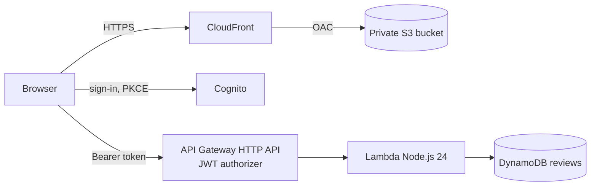

# Fulfillment Watch

Fulfillment Watch is an Order Exception Workbench for stalled paid orders. A fulfillment lead sees paid orders that have not shipped after a threshold, checks the evidence and the suggested action, and marks each order reviewed.

All data is synthetic: 17 bundled order records in `src/data/orders.ts`. The AWS stack runs in **us-east-1**.

More documentation:

- [docs/architecture.md](docs/architecture.md): components, request flow, data model
- [docs/well-architected.md](docs/well-architected.md): operational excellence, security and cost
- [docs/test-evidence.md](docs/test-evidence.md): test counts, deployed checks, screenshots
- [docs/cost-estimate.md](docs/cost-estimate.md): monthly cost by service
- [docs/scope-verification.md](docs/scope-verification.md): deployed status-code checks
- [docs/demo-script.md](docs/demo-script.md) and [docs/presentation-outline.md](docs/presentation-outline.md)

## The rule: "Paid and unfulfilled"

An order is flagged when all of these hold at the evaluation time:

- the payment status is `paid` (compared after trim and lowercase),
- at least the threshold has passed since payment (default 24 hours, so exactly 24 hours is flagged),
- no units are fulfilled,
- the order is not canceled,
- the refund status is not `full` (a partial refund stays flagged).

The evaluation time is fixed at `2026-11-20T12:00:00Z`. The queue sorts the oldest payment first, then by order ID. A record with a missing, invalid or future payment timestamp, a missing field, a bad quantity, an unknown refund status or a duplicate order ID is skipped and listed with its reason on the Data quality page. The other records still evaluate.

With the bundled data the rule checks 17 records, flags 6 (#1051, #1049, #1050, #998, #1042, #1043) and skips 5 (#1053, #1054, #1055, #1056 and the duplicate #1043).

The rule is a pure function in `src/rules/`. The browser and the Lambda use the same code.

## Local mode and API mode

One build-time variable, `VITE_API_URL`, picks the mode.

| | Local mode | API mode |
| --- | --- | --- |
| When | `VITE_API_URL` is empty or unset | `VITE_API_URL` is set at build time |
| Sign-in | None | Cognito managed login (authorization code grant with PKCE) |
| Queue | Evaluated in the browser | `GET /queue` from the API |
| Reviews | Browser local storage | DynamoDB through `POST /reviews`, stored with the reviewer's username |
| Network calls | None | Only through `src/api` |

The page layout is the same in both modes. API mode adds a "Sign out" link in the header and shows the reviewer in the review status text, for example "Reviewed by lead1 2026-11-20 20:55 UTC".

## Architecture



See [docs/architecture.md](docs/architecture.md) for details.

## Run locally

Install once with `npm install`. Run these commands in your own terminal.

### Local mode

```sh
npm run dev
```

The dev server uses port 5173 and the base path `/absproxy/5173/`, which the IDE proxy expects. The queue opens with no sign-in and makes no network request.

### API mode against a deployed stack

1. Deploy with `-c allowLocalhost=true` so the API accepts requests from `http://localhost:5173`.
2. Start the dev server with the stack outputs and the root base path:

```sh
VITE_API_URL=<ApiUrl> VITE_COGNITO_DOMAIN=<CognitoDomainUrl> VITE_COGNITO_CLIENT_ID=<AppClientId> npx vite --base /
```

3. Open `http://localhost:5173/`. The browser goes to the Cognito sign-in page and comes back to the page you opened.

Status: not verified. The deployed stack used `allowLocalhost=false`, so this path was never run.

### Tests and checks

```sh
npm test -- --run
npm run check
npm run build
npm run cdk -- synth
```

`npm run check` runs ESLint, gitleaks and semgrep. The two scanners must be installed.

## Deploy

You need AWS credentials and a CDK-bootstrapped account in us-east-1. Run `cdk bootstrap` yourself once if needed.

1. Deploy the stack:

```sh
npm run cdk -- deploy -c allowLocalhost=false
```

It prints the outputs `ApiUrl`, `UserPoolId`, `AppClientId`, `CognitoDomainUrl`, `SiteUrl`, `SiteBucketName` and `DistributionId`. The first deploy took 212 seconds.

2. Build the front end with those outputs:

```sh
VITE_API_URL=<ApiUrl> VITE_COGNITO_DOMAIN=<CognitoDomainUrl> VITE_COGNITO_CLIENT_ID=<AppClientId> npm run build
```

Set the variables in the same shell as the build. Without them, the build is in Local mode.

3. Upload and refresh the cache:

```sh
aws s3 sync dist s3://<SiteBucketName> --delete
aws cloudfront create-invalidation --distribution-id <DistributionId> --paths "/*"
```

4. Open `<SiteUrl>`.

### Users

Self sign-up is off, so an administrator creates users. Choose the passwords yourself and never put them in the repository.

```sh
aws cognito-idp admin-create-user --region us-east-1 --user-pool-id <UserPoolId> --username <name> --message-action SUPPRESS
aws cognito-idp admin-set-user-password --region us-east-1 --user-pool-id <UserPoolId> --username <name> --password '<password>' --permanent
aws cognito-idp admin-add-user-to-group --region us-east-1 --user-pool-id <UserPoolId> --username <name> --group-name fulfillment-lead
```

### Tear down

```sh
npm run cdk -- destroy
```

This deletes the stack, including the table, the site bucket and its objects, and the user pool. Status: not verified, because the stack has not been destroyed yet.

## Sign in

Open the site URL and sign in on the Cognito page. The deployed pool has two test users:

| Username | Group | What you see |
| --- | --- | --- |
| `lead1` | `fulfillment-lead` | The queue. Can mark orders reviewed. |
| `outsider1` | none | "No access" and a Sign out link. No queue data. |

The passwords are not in the repository. The operator keeps them outside the repo, in `~/.hackathon-test-users` on the deploy machine. To switch users, select Sign out first. It also ends the Cognito session.

## Change the threshold or the evaluation time

The Lambda reads two environment variables. Set them through CDK context at deploy time.

| Setting | Variable | CDK context | Default |
| --- | --- | --- | --- |
| Threshold in hours | `FULFILLMENT_THRESHOLD_HOURS` | `thresholdHours` | `24` |
| Evaluation time | `EVALUATION_TIME` | `evaluationTime` | `2026-11-20T12:00:00Z` |

1. Redeploy with the new value, for example `npm run cdk -- deploy -c allowLocalhost=false -c thresholdHours=48`. A threshold must be a decimal number above 0. An evaluation time must be ISO 8601 UTC ending in `Z`. A bad value stops `cdk synth` with an error.
2. To confirm, sign in and check the header's evaluation time and the threshold in the "Reason" column, for example "threshold 48 h". A request cannot override either value.

If a bad value reaches the Lambda another way, `GET /queue` returns HTTP 500 with a generic message, and the cause goes to the function's CloudWatch log.

Status: changing these values on the deployed stack is not verified. Only the defaults were deployed. Unit and property tests cover the parsing and the 500 response.

## Known limits

- The Rule page shows the evaluation time and threshold from `src/config.ts`, not the deployed values. After a change, read them from the header and the "Reason" column.
- A run of 401 responses can loop the browser between sign-in and the app. There is no retry guard.
- `http://localhost:5173` is always a registered Cognito callback and logout URL, even when `allowLocalhost` is false. CORS does exclude it in that case.
- CloudFront sends no security headers (CSP, HSTS).
- `cdk destroy` deletes the table and the user pool. The table has no point-in-time recovery.
- The two alarms have no notification target. They show only in CloudWatch.
- No refresh tokens. The access token lasts 1 hour, after which the user signs in again.
- The order data is a bundled synthetic dataset. There is no live order system.
