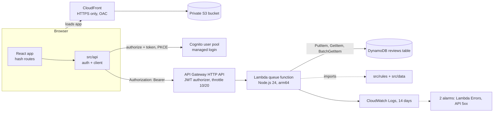

# Architecture

Fulfillment Watch is a React single-page app with an optional AWS backend. The whole backend is one CDK stack, `FulfillmentWatch`, in `infra/lib/stack.ts`, deployed to us-east-1.



## Components

| Component | What it does | Where |
| --- | --- | --- |
| React app | Queue, order, Data quality and Rule pages. Same layout in Local and API mode. | `src/App.tsx`, `src/pages/`, `src/components/` |
| Rule | Pure `evaluate(orders, evaluationTime, thresholdHours)`. No clock, storage or DOM. | `src/rules/paidUnfulfilled.ts`, `src/rules/queue.ts` |
| Mode switch | `isApiMode(VITE_API_URL)`. Local mode never loads `src/api`. | `src/api/config.ts`, `src/main.tsx` |
| Sign-in | PKCE authorization code flow. Saves the hash route, exchanges the code and restores the route. The token lives in `sessionStorage` and is never refreshed. | `src/api/auth.ts`, `src/api/pkce.ts` |
| API client | `getQueue`, `postReview`. 10-second timeout and typed errors (`unauthorized`, `forbidden`, `timeout`, `network`, `http`). | `src/api/client.ts`, `src/api/wire.ts` |
| Review repositories | One async interface. Local wraps the unchanged `src/storage/reviews.ts`. API wraps the client. | `src/storage/reviewRepository.ts`, `localRepository.ts`, `apiRepository.ts` |
| CloudFront + S3 | Serves `dist/`. The bucket blocks all public access, uses S3-managed encryption and enforces SSL. CloudFront reads it through origin access control and redirects HTTP to HTTPS. | `infra/lib/stack.ts` |
| Cognito | User pool with self sign-up off and the Essentials plan. One group, `fulfillment-lead`. Resource server `fulfillment-watch` with scope `api`. Domain `fulfillment-watch-690559`. Public app client with the code grant only and a 1-hour access token. | `infra/lib/stack.ts` |
| API Gateway | HTTP API with exactly `GET /queue` and `POST /reviews`. Each route has the JWT authorizer and requires scope `fulfillment-watch/api`. Default stage throttling is 10 requests per second with a burst of 20. CORS allows the CloudFront origin only. | `infra/lib/stack.ts` |
| Lambda | One function for both routes. Node.js 24, arm64, 256 MB, 10-second timeout. Its own IAM role. | `server/handler.ts`, `server/handleRequest.ts` |
| DynamoDB | Reviews table, on-demand capacity. | `infra/lib/stack.ts`, `server/reviewStore.ts`, `server/dynamoClient.ts` |
| Observability | Function log group with 14-day retention. Alarms on Lambda `Errors` and API `5xx`, each Sum >= 1 over 5 minutes, with no actions. | `infra/lib/stack.ts` |

## Request flow

### Sign-in

1. The app starts in `src/main.tsx`. In API mode it checks for a valid token in `sessionStorage`.
2. With no token, it saves the current hash route plus a PKCE verifier and state, then redirects to `/oauth2/authorize` with scope `openid fulfillment-watch/api`.
3. Cognito redirects back with `?code=&state=`. The app checks the state and posts the code and verifier to `/oauth2/token`. There is no client secret.
4. The app stores the access token and its expiry (`expires_in` minus 30 seconds), removes the query from the URL and restores the saved route. Then it renders.

The app requests `openid` together with the API scope because Cognito only adds the `cognito:groups` claim to the access token when `openid` is requested. We observed this on the deployed pool on 2026-11-20. Without `openid`, lead1 was refused with 403.

### GET /queue

1. API Gateway checks the token: signature, issuer, audience, expiry and scope. A missing or bad token gets 401 and a missing scope gets 403. The function does not run in either case.
2. The Lambda reads the claims from `requestContext.authorizer.jwt.claims`. A user not in `fulfillment-lead` gets 403. The Lambda never calls Cognito.
3. It reads `FULFILLMENT_THRESHOLD_HOURS` and `EVALUATION_TIME`. A bad value gets a generic 500.
4. It runs `evaluate(DATASET, evaluationTime, thresholdHours)` and fetches reviews with `BatchGetItem` (consistent reads) for the flagged orders only.
5. It returns rows in evaluator order, each with `review: null` or `{reviewedAt, reviewer}`, plus the skipped records, the checked count, the evaluation time, the threshold and the rule ID.

### POST /reviews

1. Token and group checks run as above. A missing `username` claim gets 403.
2. The body must be JSON with non-empty string `orderId` and `ruleId`. If not, the response is 400 naming the field. A `ruleId` other than `paid-unfulfilled` gets 400. An order not in the current queue gets 400. Any `reviewer` in the body is ignored.
3. The Lambda reads the clock once and calls `PutItem` with `attribute_not_exists(orderId)`.
4. If the write succeeds, it returns 201 with the review. If the condition fails, it reads the stored item with a consistent `GetItem` and returns 200 with the first timestamp and reviewer.

### Errors in the app

| API result | App behavior |
| --- | --- |
| 401 | Discards the token and redirects to sign-in. |
| 403 on load or save | "No access" screen with Sign out. No Retry. |
| Timeout, network error, other non-2xx on load | "Could not load the queue." with Retry. |
| Same on save | Order stays Open, with an inline error and a Retry next to it. |

Every 5xx body is the fixed `{"error":{"code":"internal_error","message":"The request could not be completed."}}`. The log line for a 5xx has the operation, error name and message, and never the event, headers or claims.

## Data model

### DynamoDB item (reviews table)

| Attribute | Type | Notes |
| --- | --- | --- |
| `orderId` | String, partition key | Order ID as supplied |
| `ruleId` | String, sort key | Always `paid-unfulfilled` |
| `reviewedAt` | String | ISO 8601 UTC with milliseconds, for example `2026-11-20T20:49:25.396Z` |
| `reviewer` | String | `username` claim of the access token |

The key and the conditional put allow at most one item per `(orderId, ruleId)`. The function never updates or deletes an item. A review of an order that no longer matches the rule stays in the table and is left out of the queue.

### Wire format (`GET /queue`)

```ts
interface QueueResponse {
  ruleId: string            // 'paid-unfulfilled'
  evaluationTime: string
  thresholdHours: number
  checkedCount: number
  rows: { order: Order; elapsedMs: number; review: { reviewedAt: string; reviewer: string } | null }[]
  skipped: { orderId: string | null; index: number; reasons: { code: string; field?: string; message: string }[] }[]
}
```

`src/api/wire.ts` encodes this on the server and decodes it on the client. The decoder rejects a malformed body instead of returning partial data.

### Browser storage

| Key | Storage | Mode | Content |
| --- | --- | --- | --- |
| `fulfillment-watch.reviews.v1` | `localStorage` | Local | Array of `{orderId, ruleId, reviewedAt}` |
| `fw.token` | `sessionStorage` | API | Access token and expiry |
| `fw.pkce` | `sessionStorage` | API, during sign-in only | PKCE verifier and state |
| `fw.route` | `sessionStorage` | API, during sign-in only | Saved hash route |

In API mode the app writes nothing to `localStorage`. The deployed browser check on 2026-11-20 found no `localStorage` keys.
